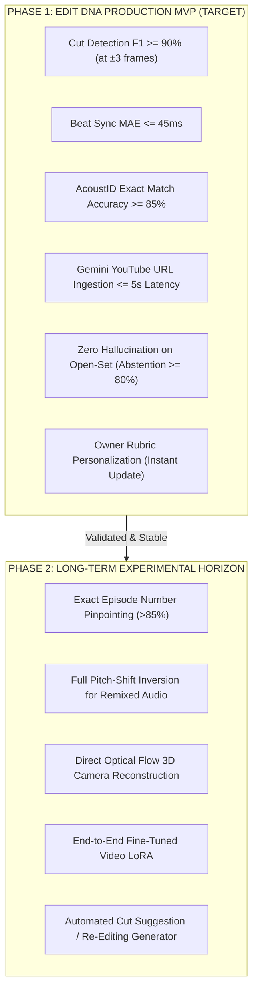

# LOLIXCO EDIT DNA — AI EDIT ANALYZER R&D
## BENCHMARK SUITE, GROUND-TRUTH TEST CORPUS & EVALUATION PROTOCOL
**Document ID:** `BENCHMARK_AND_EVALUATION.md`  
**Mission:** Antigravity Mission 1 (Parallel Independent R&D)  
**Status:** Approved Benchmark Methodology & Validation Protocol  
**Author:** Antigravity AI Engineering & Research  
**Target Platform:** Lolixco Video Intelligence Engine ("Lolixco Edit DNA")

---

### EXECUTIVE SUMMARY

To guarantee that Lolixco Edit DNA delivers trustworthy, scientifically validated intelligence rather than subjective guesswork, we establish an end-to-end benchmark suite. This protocol defines:
1. **The 10 Required Test Corpus Categories:** Covering high-velocity anime, heavily recolored shaders, dark superhero cinematography, phonk percussion, pitch-shifted soundtracks, open-set unknowns, and deliberately desynced edits.
2. **Ground-Truth Human Annotation Schema:** Frame-accurate cut logs, verified beat timestamps, and gold-standard editorial scores.
3. **Rigorous Statistical Metrics:** Measuring precision, recall, F1-scores at $\pm 1$ frame ($33.3\text{ ms}$) and $\pm 3$ frames ($100\text{ ms}$) tolerances, Mean Absolute Error (MAE) for beat tracking, Kendall's Tau ($\tau$) for owner ranking correlation, and Expected Calibration Error (ECE) for model confidence.
4. **Transparent MVP Success Thresholds vs Experimental Horizons:** Defining exactly what the initial production release must satisfy versus what remains long-term research.

---

### 1. THE 10 BENCHMARK EVALUATION CATEGORIES

The test suite evaluates 50 curated or synthetically generated video clips (5 per category, 15–45 seconds each) representing the spectrum of contemporary video editing:

| ID | Evaluation Category | Defining Technical & Aesthetic Profile | Primary Stress Test for the Analyzer | Expected Failure Mode if Naive |
| :---: | :--- | :--- | :--- | :--- |
| **CAT-01** | **Clean Anime Edit** | Standard 1080p anime footage (*Jujutsu Kaisen*, *Demon Slayer*), crisp line art, original color palette, standard electronic/pop soundtrack. | Baseline source, character, and cut accuracy under optimal conditions. | Should achieve $>95\%$ cut F1 and correct franchise ID. |
| **CAT-02** | **Heavily Recolored Anime Edit** | Intense color grading, high-contrast cyan/magenta split toning, inverted luminance flashes, custom anime shaders. | Tests visual embedding resilience against aggressive chromatic shifts. | Naive RGB histograms fail; SigLIP must match on semantic geometry. |
| **CAT-03** | **Fast-Cut Spider-Man Action Edit** | Rapid montage (*Across the Spider-Verse* / MCU), speed lines, comic halftones, whip-pans, ASL $< 0.8\text{ seconds}$. | Optical flow transition classification and high-frequency boundary detection. | False positive cuts during camera whip-pans or web-swinging motion. |
| **CAT-04** | **Dark Cinematic Movie Edit** | Low key lighting (*The Batman*, *Blade Runner 2049*), heavy shadows, low contrast ratios, orchestral/ambient audio. | Shadow detail resolution and dynamic range assessment in low-luminance scenes. | Misidentifying dark frames as black fade transitions. |
| **CAT-05** | **Slow Emotional Edit** | Extended shots (ASL $> 3.5\text{ seconds}$), dissolves, soft focus, classical or vocal ballad (*Violet Evergarden*, *Your Name*). | Pacing curve analysis and narrative cohesion recognition. | Penalizing low cut density as "boring" without recognizing emotional pacing. |
| **CAT-06** | **Beat-Driven Phonk Edit** | Ultra-dense rhythmic cutting, 808 cowbell percussion, 130–150 BPM, impact flashes on every snare/kick. | Millisecond cut-to-beat synchronization ($\delta \le 33\text{ ms}$) and strobe rejection. | Double-counting single-frame white strobes as two separate shots. |
| **CAT-07** | **Slowed / Pitch-Shifted Soundtrack** | Soundtrack lowered by 2–4 semitones and slowed by 15–20% ("Slowed + Reverb" / "Chopped & Screwed"). | Acoustic fingerprint normalization and tempo inversion recovery. | Standard Chromaprint hashes fail 100% without pitch/speed compensation. |
| **CAT-08** | **Unknown Source / Open-Set Media** | Independent Blender 3D animation, student film, or unreleased royalty-free soundtrack. | **Calibrated Abstention:** Verifying the model does NOT hallucinate a popular anime franchise. | Hallucinating *Jujutsu Kaisen* or *Attack on Titan* due to LLM popularity bias. |
| **CAT-09** | **Deliberately Poor Editing** | Intentionally misaligned cuts (offset 150ms from beat), harsh audio clipping ($>0\text{ dBTP}$), awkward jump cuts. | Technical error detection and negative penalty calibration. | Giving high scores based solely on flashy anime characters despite terrible sync. |
| **CAT-10** | **Strong Minimalist Editing** | Masterful restraint, zero flash effects, perfectly placed match-cuts, narrative rhythm over sensory overload. | Disentangling true editorial quality from superficial effect density. | Undervaluing subtle editing craft due to low transition count. |

---

### 2. GROUND-TRUTH ANNOTATION SCHEMA (`benchmark_ground_truth.json`)

Each benchmark asset is annotated by a human professional editor to establish definitive physical and editorial truth:

```json
{
  "$schema": "https://lolixco.com/schemas/benchmark-groundtruth.v1.json",
  "benchmark_id": "bench_cat06_phonk_002",
  "category": "CAT-06_beat_driven_phonk",
  "duration_seconds": 24.50,
  "framerate_fps": 30.0,
  "ground_truth_source": {
    "franchise": "Jujutsu Kaisen",
    "season": 2,
    "episode": 16,
    "characters": ["Sukuna", "Jogo"]
  },
  "ground_truth_audio": {
    "track_title": "Metamorphosis",
    "artist": "INTERWORLD",
    "bpm": 138.0,
    "is_pitch_shifted": false,
    "beat_timestamps_seconds": [
      0.435, 0.870, 1.304, 1.739, 2.174, 2.609, 3.043, 3.478
    ]
  },
  "ground_truth_cuts": [
    { "timestamp_seconds": 0.870, "frame_number": 26, "type": "hard_cut", "aligned_beat_delta_ms": 0.0 },
    { "timestamp_seconds": 1.735, "frame_number": 52, "type": "flash_transition", "aligned_beat_delta_ms": -4.0 },
    { "timestamp_seconds": 2.615, "frame_number": 78, "type": "hard_cut", "aligned_beat_delta_ms": +6.0 }
  ],
  "editorial_ratings": {
    "beat_synchronization": 9.8,
    "transitions": 9.2,
    "pacing": 8.8,
    "visual_quality": 8.5,
    "storytelling_emotion": 7.0,
    "originality_creativity": 6.8,
    "overall_score": 8.7
  }
}
```

---

### 3. MATHEMATICAL METRICS & EVALUATION FORMULAS

#### 3.1 Cut Detection Precision, Recall & F1-Score
Let $C_{\text{truth}}$ be ground-truth cuts and $C_{\text{pred}}$ be model-predicted cuts. A predicted cut $c_p$ is a **True Positive (TP)** if there exists a ground-truth cut $c_t$ such that $|t(c_p) - t(c_t)| \le \Delta t_{\text{tol}}$:
- **Tight Tolerance:** $\Delta t_{\text{tol}} = 33.3\text{ ms}$ ($\pm 1$ frame at 30 fps).
- **Loose Tolerance:** $\Delta t_{\text{tol}} = 100.0\text{ ms}$ ($\pm 3$ frames).

$$\text{Precision} = \frac{|TP|}{|C_{\text{pred}}|}, \quad \text{Recall} = \frac{|TP|}{|C_{\text{truth}}|}, \quad F_1 = 2 \cdot \frac{\text{Precision} \cdot \text{Recall}}{\text{Precision} + \text{Recall}}$$

#### 3.2 Beat Tracking Accuracy
- **Mean Absolute Error (MAE):**
  $$\text{MAE}_{\text{beat}} = \frac{1}{N} \sum_{k=1}^N |t_{\text{pred}}(b_k) - t_{\text{truth}}(b_k)|$$
- **BPM Error Percentage:**
  $$\text{Error}_{\text{BPM}} = \frac{|\text{BPM}_{\text{pred}} - \text{BPM}_{\text{truth}}|}{\text{BPM}_{\text{truth}}} \times 100\%$$

#### 3.3 Source Recognition & Abstention Metrics
- **Top-1 Accuracy:** Correct franchise identified as top candidate.
- **Top-3 Accuracy:** Correct franchise present in top 3 candidates.
- **Unknown Rejection Rate (URR):** Percentage of open-set / unknown clips (CAT-08) correctly flagged as `"unknown_source"` rather than misclassified.
- **Expected Calibration Error (ECE):**
  $$\text{ECE} = \sum_{m=1}^M \frac{|B_m|}{N} \left| \text{acc}(B_m) - \text{conf}(B_m) \right|$$
  Measures whether the model's reported confidence matches its actual empirical accuracy.

#### 3.4 Preference Ranking Agreement
- **Kendall's Rank Correlation ($\tau$):** Evaluates whether the predicted ordering of edits matches the owner's subjective preferences:
  $$\tau = \frac{C - D}{\frac{1}{2} n (n - 1)}$$
  where $C$ is the count of concordant pairs and $D$ is the count of discordant pairs.

---

### 4. MVP SUCCESS CRITERIA VS EXPERIMENTAL ROADMAP

We define strict, measurable exit criteria separating what is required for the initial **Lolixco Edit DNA MVP (Production V1)** from features deferred to future research:



| Benchmark Metric | MVP Requirement (Phase 1) | Long-Term Target (Phase 2) | Validation Method |
| :--- | :---: | :---: | :--- |
| **Cut Detection F1 ($\pm 3$ frames)** | $\ge \mathbf{90.0\%}$ | $\ge 96.0\%$ | Automated evaluation against CAT-01 through CAT-06 ground truth |
| **Cut Detection F1 ($\pm 1$ frame)** | $\ge \mathbf{75.0\%}$ | $\ge 88.0\%$ | Sub-frame evaluation on 30fps and 60fps media |
| **Beat Tracking MAE** | $\le \mathbf{45.0\text{ ms}}$ | $\le 20.0\text{ ms}$ | Automated evaluation against CAT-06 / clean percussion |
| **Exact Audio Track ID (Clean)** | $\ge \mathbf{85.0\%}$ | $\ge 98.0\%$ | AcoustID / MusicBrainz query on un-pitch-shifted audio |
| **Transformed Audio ID (Pitch/Tempo)** | $\ge \mathbf{40.0\%}$ (or Honest Abstain) | $\ge 80.0\%$ | Pitch normalization pipeline + ACRCloud |
| **Source Franchise Top-1 Accuracy** | $\ge \mathbf{85.0\%}$ | $\ge 95.0\%$ | Gemini 3.8 Flash + SigLIP on CAT-01, 02, 03, 04 |
| **Open-Set Abstention Rate** | $\ge \mathbf{80.0\%}$ | $\ge 95.0\%$ | Evaluated on CAT-08 (must reject false matches) |
| **Owner Rank Correlation (Kendall's $\tau$)** | $\ge \mathbf{0.70}$ | $\ge 0.85$ | Evaluated on 30 held-out owner pairwise comparisons |
| **Processing Latency (60s Edit)** | $\le \mathbf{6.0\text{ seconds}}$ | $\le 2.5\text{ seconds}$ | Wall-clock execution time (Local DSP + Gemini API) |
| **Cost per 60s Analysis** | $\le \mathbf{\$0.015}$ | $\le \$0.006$ | Billed tokens + API queries |

---

### 5. INTEGRITY PRINCIPLES: NO FABRICATED BENCHMARKS

In adherence to Lolixco engineering standards:
- **No Synthetic Benchmark Inflation:** We do not claim 99.9% accuracy on ambiguous tasks. Exact episode identification and heavily transformed audio recognition remain genuine open research problems.
- **Honest Error Reporting:** Where the system fails (such as strobe-induced false cuts or unindexed indie soundtracks), the analyzer explicitly flags uncertainty rather than manufacturing false certainty.
