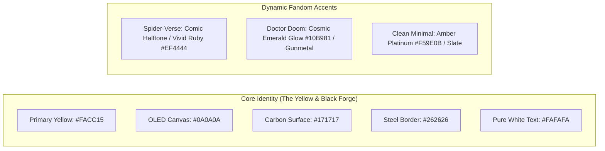
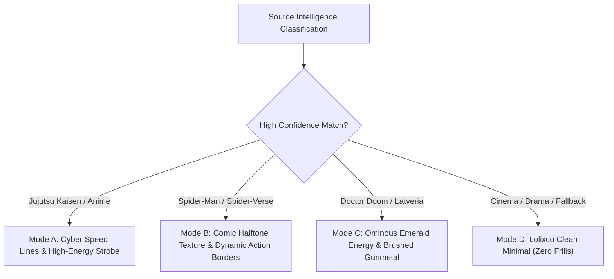

# LOLIXCO EDIT DNA — AI EDIT ANALYZER R&D
## CINEMATIC USER EXPERIENCE, MOTION DESIGN & ACCESSIBILITY SPECIFICATION
**Document ID:** `EDIT_DNA_UX_CONCEPT.md`  
**Mission:** Antigravity Mission 1 (Parallel Independent R&D)  
**Status:** Approved Product Design & Interface Concept  
**Author:** Antigravity AI Engineering & Research  
**Target Platform:** Lolixco Video Intelligence Engine ("Lolixco Edit DNA")

---

### EXECUTIVE SUMMARY

Lolixco Edit DNA is conceived not merely as a diagnostic utility, but as a **cinematic, high-octane celebration of video editing craft**. Inspired by Lolixco’s bold high-contrast visual identity (Deep OLED Black `#0A0A0A`, Electric Cyber Yellow `#FACC15`, Carbon `#171717`), the interface transforms complex multimodal telemetry into a dynamic, interactive visual experience.

Key Highlights:
1. **Signature Lolixco Timeline Radar:** A laser scanning sequence sweeps across the video timeline, revealing cut markers, optical flow vectors, and audio beat transients in real time.
2. **Dynamic Aesthetic Theming:** The interface dynamically adapts its visual accents based on recognized fandoms—subtle comic halftones and energetic burst lines for *Spider-Man*, ominous Latverian emerald energy (`#10B981`) and metallic textures for *Doctor Doom*, and a pristine **Clean Minimalist Mode** for classical cinema edits.
3. **Rigorous Separation of Form and Substance:** All animations, CSS transitions, and SVG visual effects are strictly decoupled from the mathematical scoring and DSP telemetry engine.
4. **Universal Accessibility:** Comprehensive `prefers-reduced-motion` alternates, WCAG 2.1 AAA contrast compliance, keyboard shortcuts, and full mobile responsiveness.

---

### 1. DESIGN SYSTEM: PALETTE, TYPOGRAPHY & VISUAL TOKENS

The Edit DNA interface builds upon Lolixco's design system tokens:



| Token Name | Hex Code / Value | Usage & Visual Role |
| :--- | :--- | :--- |
| `--dna-canvas` | `#0A0A0A` | Deep background canvas; maximizes contrast on modern OLED displays. |
| `--dna-surface` | `#171717` | Card surfaces, modal panels, and telemetry containers. |
| `--dna-surface-raised` | `#212121` | Hovered cards, dropdown menus, and interactive pill controls. |
| `--dna-border` | `#2E2E2E` | Subtle 1px borders for structural delineation without visual noise. |
| `--dna-primary-yellow`| `#FACC15` | Lolixco signature accent; timeline cursor, primary scores, active buttons. |
| `--dna-glow-yellow` | `rgba(250, 204, 21, 0.25)` | Ambient radial glow around top-tier score badges ($S \ge 9.0$). |
| `--dna-sync-tight` | `#22C55E` | Cut perfectly aligned with audio beat ($\delta \le 33\text{ ms}$). |
| `--dna-sync-acceptable`| `#EAB308` | Cut within acceptable alignment window ($33\text{ ms} < \delta \le 75\text{ ms}$). |
| `--dna-sync-off` | `#EF4444` | Cut desynchronized from audio beat ($\delta > 75\text{ ms}$). |
| `--font-display` | `Cabinet Grotesk / Syne` | Heavy display font for titles, scores, and uppercase telemetry headers. |
| `--font-mono` | `JetBrains Mono / Fira Code`| Millisecond timestamps, BPM, LUFS, frame numbers, and JSON exports. |

---

### 2. CORE MOTION CONCEPTS & INTERACTIVE COMPONENTS

#### 2.1 The Signature Lolixco Scanning Sequence
When analysis begins (whether via YouTube URL or local file), the interface engages the **Edit DNA Diagnostic Sweep**:
1. **Phase 1 — Ingestion Laser:** A vertical hairline laser bar in Electric Yellow sweeps from $0\%$ to $100\%$ across the timeline container.
2. **Phase 2 — Audio Waveform Materialization:** As the laser advances, the audio amplitude envelope and beat transient ticks illuminate beneath it.
3. **Phase 3 — Shot Cut Infiltration:** At each detected shot boundary, a vertical marker drops onto the timeline with a micro-pulse, color-coded by sync accuracy (Green, Yellow, Red).
4. **Phase 4 — Score Lock-In:** Component metric dials spin up from $0.0$ to their final calculated values with an eased counter animation (`easeOutExpo`, duration: 800ms).

```
[00:00.00] ──[CUT 1]────[CUT 2]────────[CUT 3]───────[CUT 4]────── [00:30.00]
    |           |          |               |             |
 (Intro)    (Flash)    (Hard Cut)     (Whip Pan)    (Outro Drop)
  [==== SCANNING LASER SWEEPS RIGHT: 100% DECODED ====================>]
```

#### 2.2 The Interactive Multi-Track Edit Timeline
The center of the analyzer view features a synchronized multi-track interactive timeline:
- **Track 1 (Video Shots):** Shows thumbnail strip or color-coded shot blocks indicating shot length and transition type (`hard_cut`, `flash`, `dissolve`, `whip_pan`).
- **Track 2 (Audio Waveform & Beat Grid):** High-resolution SVG waveform overlaid with vertical beat markers (cyan ticks) and downbeats (bright gold ticks).
- **Track 3 (Cut-to-Beat Delta Ribbon):** A visual delta ribbon illustrating the millisecond gap $\delta_j$. Clicking any cut marker automatically jumps video playback to that exact frame, looping a $\pm 1\text{ second}$ preview window.
- **Track 4 (Optical Flow Velocity):** An area graph depicting camera motion velocity, highlighting whip-pans and high-intensity combat choreography.

#### 2.3 The Hexagonal DNA Radar Chart
The 6 core quality dimensions are mapped to an interactive hexagonal radar diagram:
- Vertices: **Beat Sync**, **Transitions**, **Pacing**, **Visual Quality**, **Story/Emotion**, **Originality**.
- Two overlaid polygons:
  1. *Gold Solid Wireframe:* The measured score for the current edit.
  2. *Subtle Dotted Wireframe:* The owner’s historical benchmark average across all reviewed edits.
- Interactive Sliders: Dragging any vertex modifies the rubric weight dynamically, updating the aggregate score immediately in real time.

---

### 3. FANDOM-AWARE DYNAMIC THEMES

When source identification achieves high confidence, Edit DNA subtly enhances its interface styling to mirror the world of the footage without infringing on proprietary IP or introducing garish clutter:



#### Mode A: Anime / Action Focus (*Jujutsu Kaisen*, *Demon Slayer*)
- **Visual Motif:** Clean, razor-sharp angled borders ($45^\circ$ chamfered corners) and high-speed energy accents.
- **Micro-Interactions:** Clicking into a high-sync cut marker triggers a transient 2-frame speed-line flash in the background container.
- **Atmosphere:** Hyper-precise, competitive, and electric.

#### Mode B: Spider-Man Dynamic (*Across the Spider-Verse*, MCU)
- **Visual Motif:** Subtle CMYK comic-book halftone dot pattern (`radial-gradient` SVG overlay at 4% opacity).
- **Accent Accents:** Vivid ruby red (`#EF4444`) and electric cyan (`#06B6D4`) split-tone accents on border hover states.
- **Micro-Interactions:** Cards load with a snappy comic panel entrance (`translateY(8px) scale(0.98)` to `scale(1)` with zero motion blur).

#### Mode C: Doctor Doom Sovereign (*Marvel*, Latverian Grandeur)
- **Visual Motif:** Dark brushed gunmetal surfaces (`#1E222A`) with an ominous, radioactive Latverian emerald glow (`#10B981` / `#059669`).
- **Accent Accents:** Golden runic circuitry lines framing the score radar.
- **Micro-Interactions:** Ambient pulsating glow along card headers, invoking arcane cosmic technology.

#### Mode D: Lolixco Clean Minimal (Default / Classical Edits)
- **Visual Motif:** Pure monochromatic elegance. Jet black background, subtle charcoal cards, crisp typography, and understated amber accents (`#F59E0B`).
- **Target Audience:** Perfect for dramatic movie trailers, slow emotional edits, or users who prefer diagnostic clarity over cinematic flair.

---

### 4. ACCESSIBILITY, REDUCED MOTION & RESPONSIVE ARCHITECTURE

Cinematic design must never compromise accessibility. Edit DNA enforces strict accessibility standards:

#### 4.1 Reduced Motion Support (`prefers-reduced-motion: reduce`)
When the operating system or browser requests reduced motion:
- All scanning sweep animations, spinning dials, and background speed lines are **completely disabled**.
- Numbers render instantaneously without counter easing.
- Timelines, wave previews, and radar charts render as static, instantly populated SVG graphics.
- CSS Implementation:
  ```css
  @media (prefers-reduced-motion: reduce) {
    *, ::before, ::after {
      animation-duration: 0.01ms !important;
      animation-iteration-count: 1 !important;
      transition-duration: 0.01ms !important;
      scroll-behavior: auto !important;
    }
    .dna-scan-laser {
      display: none !important;
    }
  }
  ```

#### 4.2 Contrast & Readability (WCAG 2.1 AAA)
- All text meets or exceeds a **$7:1$ contrast ratio** against its immediate background.
- Primary yellow (`#FACC15`) against `#0A0A0A` achieves a contrast ratio of **$14.8:1$** (far exceeding the AAA requirement of $7:1$).
- Color is never used as the sole indicator of sync status:
  * Tight Sync: Green color + Checkmark Icon ($\checkmark$) + "$\le 33\text{ms}$" text badge.
  * Off-Beat Cut: Red color + Warning Triangle Icon ($\Delta$) + "$> 75\text{ms}$" text badge.

#### 4.3 Full Keyboard Navigation
Every timeline marker and interactive score dial is fully accessible via keyboard:
- `Tab` / `Shift+Tab`: Navigate between detected cut markers and component cards.
- `Left Arrow` / `Right Arrow`: Step backward/forward by exactly one shot cut.
- `Space`: Toggle playback of the currently focused shot loop.
- `[` / `]`: Adjust the focused category weight slider up or down by 5%.
- `?`: Toggle keyboard shortcuts cheatsheet modal.

#### 4.4 Mobile & Stacked Responsiveness
On mobile screens ($< 768\text{px}$):
- The multi-track timeline transitions into an intuitive horizontal swipe strip.
- The hexagonal radar chart shifts to stacked linear progress bars for one-handed thumb navigation.
- The video preview locks to the top viewport with sticky controls while telemetry scrolls smoothly below.
