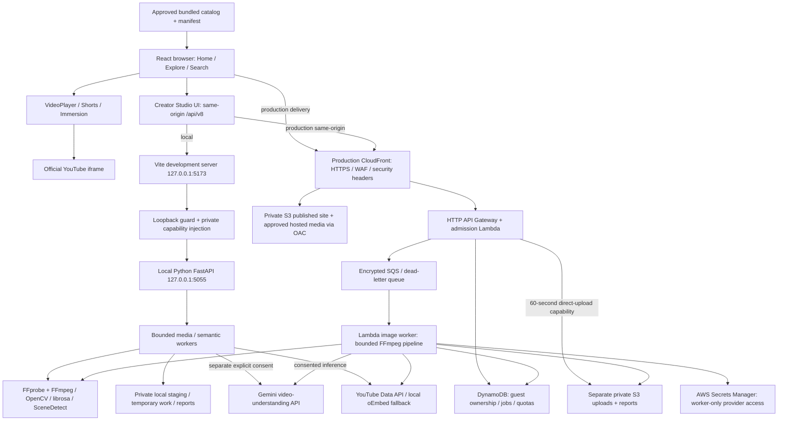

# Lolixco engineering and operations handoff

**IF YOU ARE A NEW AI ENGINEERING AGENT, START HERE:** follow the [first 30 minutes](#if-you-are-a-new-ai-engineering-agent-start-here), then read this guide completely before choosing work.

Snapshot reviewed **11 November 2026 (IST)** against authoritative `main` commit `2bc633f2f72c89eaf464ff49a3c46a12f0052272` (merged PR #21). This is documentation, not deployment authorization. Recheck Git and service state before acting. Private machine/account identifiers and recovery inventories belong in the owner's separate local handoff, never here.

## Contents

- [First 30 minutes](#if-you-are-a-new-ai-engineering-agent-start-here)
- [Verified state and evidence](#verified-state-and-evidence)
- [Product and boundaries](#product-and-boundaries)
- [Windows 11 and WSL2 setup](#windows-11-and-wsl2-setup)
- [Local startup and commands](#local-startup-and-commands)
- [Architecture and file ownership](#architecture-and-file-ownership)
- [Creator Studio pipeline](#creator-studio-pipeline)
- [API contracts and recovery](#api-contracts-and-recovery)
- [Configuration and credentials](#configuration-and-credentials)
- [AWS architecture and security](#aws-architecture-and-security)
- [Deployment and rollback](#deployment-and-rollback)
- [DNS, TLS and company boundaries](#dns-tls-and-company-boundaries)
- [Catalog, rights and private research](#catalog-rights-and-private-research)
- [Tests and verification](#tests-and-verification)
- [Status and next work](#status-and-next-work)
- [Troubleshooting and disaster recovery](#troubleshooting-and-disaster-recovery)
- [Quick reference](#quick-reference)

## IF YOU ARE A NEW AI ENGINEERING AGENT, START HERE

The times below are orientation targets. Reading and checks may take longer; do not skip boundaries to meet a timer.

1. **Minutes 0–3: verify identity.** Run `pwd`, `git remote -v`, `git status --short --branch`, `git branch -vv`, `git log -5 --oneline` and `git worktree list`. The engineering repository is [GolixcoAI/lolixco](https://github.com/GolixcoAI/lolixco). `Golixco/lolixco` is the separate prototype named in the owner's handoff; its code was not audited here. Stop if the engineering remote differs. Preserve every existing modification and active worktree.
2. **Minutes 3–10: read this guide completely**, [README](README.md), [Stage 16 acceptance](docs/product/STAGE16_ACCEPTANCE.md), [Stage 16 release review](docs/infra/STAGE16_RELEASE_READINESS.md), [Stage 18 secrets](docs/infra/STAGE18_PROVIDER_SECRETS.md), [Stage 18B](docs/infra/STAGE18B_RELEASE_CANDIDATE.md), [Stage 18C](docs/infra/STAGE18C_MOBILE_RECOVERY.md) and [custom-domain activation](docs/infra/CUSTOM_DOMAIN_PREPARATION.md). Earlier documents describe earlier states.
3. **Minutes 10–13: inspect current work.** With GitHub authorization, `git fetch origin main`, `git log -5 --oneline origin/main` and `gh pr list --repo GolixcoAI/lolixco --state open`. Compare the requested task with active PRs. Do not reset, stash or switch another agent's workspace. This handoff used a separate worktree from freshly fetched `origin/main`.
4. **Minutes 13–17: confirm tools.** Check `node --version`, `pnpm --version`, `python3 --version`, `ffmpeg -version`, `ffprobe -version`. Follow the CI versions and lockfile below. Install only missing dependencies needed for your task.
5. **Minutes 17–21: verify local boundaries.** Start `pnpm dev` for frontend work, or the documented Python environment plus `pnpm studio` for Studio. Use `http://127.0.0.1:5173`, not a LAN bind. Understand the capability bridge, uploads, consent and signal/semantic distinction before running an analysis. Health/model discovery can contact Google locally; offline tests do not need credentials.
6. **Minutes 21–24: understand production.** Read `server/production/` and release templates. AWS inspection requires authorized read-only scope. Locate credential **names and storage references**, not their values. Never retrieve a secret to populate documentation. A working credential grants no production-change permission.
7. **Minutes 24–27: identify actual blockers.** Compare current code, CI, latest acceptance evidence and scoped live metadata. Public beta is deployed; fresh successful semantic inference and physical-device coverage remain separate questions. Do not revive superseded Stage 16 launch blockers as if nothing shipped.
8. **Minutes 27–30: select the smallest authorized task.** Use a new `codex/<task>` branch from current authoritative `main`, or a separate worktree if necessary. Make focused changes, run relevant local checks and open a PR targeting `main`. Leave merging, deployment, migrations, DNS, provider settings and destructive recovery to separately authorized operations.

## Verified state and evidence

| Evidence                                                                               | What it establishes                                                                                                                     | What it does not establish                                                                                              |
| -------------------------------------------------------------------------------------- | --------------------------------------------------------------------------------------------------------------------------------------- | ----------------------------------------------------------------------------------------------------------------------- |
| Fetched `main` above; PR #21 merged; no open PRs at initial inspection                 | Current source baseline includes release, mobile recovery and indexing activation                                                       | A source commit alone cannot identify exact bytes of every deployed object                                              |
| Live HTTPS GET of [public home](https://lol.golixco.com/), `/studio` and `/robots.txt` | DNS resolution, valid HTTPS, HTTP 200, HSTS; public indexing allowed                                                                    | Full browser/device/playback acceptance                                                                                 |
| Live GET of `/api/v8/health`                                                           | HTTP 200, API version `8.0.0`, `direct_upload: true`, configured daily limits and noindex                                               | Its `provider.status: connected` is derived from `AI_ENABLED`, **not a live Gemini authentication or generation probe** |
| Current `server/production/`, release templates and domain configuration               | Lambda admission API and queue worker architecture, exact origin validation, persisted production indexing                              | Absence of configuration drift; inspect scoped metadata before operations                                               |
| Latest custom-domain/Stage 18C acceptance                                              | Real cloud signal processing, partial-result handling, ownership rejection, cancellation, mobile emulation and recorded-report UI tests | Fresh successful six-score inference: latest genuine attempts returned temporary provider errors                        |
| Stage 18B acceptance                                                                   | Earlier real YouTube and upload Gemini analysis succeeded through AWS                                                                   | Current provider availability, rating accuracy, capacity guarantees                                                     |
| Stage 18 secrets acceptance                                                            | Historical Fargate credential/discovery verification and cleanup                                                                        | A persistent ECS production analyzer; current worker is Lambda                                                          |

The handoff performed no media analysis, provider generation, deployment or resource mutation. Scoped live AWS metadata confirmed completed foundation/runtime/firewall stacks, Active API and image-worker Lambdas, the enabled Deployed distribution with its alias/certificate and WAF association, seven-day API/worker logs, two alarms in OK state and a project budget. S3 metadata confirmed all three buckets' public-access blocks, ownership and encryption; site/artifact versioning, unversioned private processing and its one-day lifecycle also matched the templates. Exact identifiers and receipts are recorded only in the owner's private inventory. Full IAM effectiveness, alert delivery and provider settings remain unverified rather than inferred from historical receipts.

## Product and boundaries

Lolixco is Golixco's cinematic-edit discovery product, publicly available as a beta at `lol.golixco.com`. It helps viewers find short creative edits across anime, movies, series, gaming and multifandom work, and helps creators examine an edit's technical signals and optional experimental AI feedback. The parent company website at `golixco.com` is a separate deployment and codebase.

| Surface            | Current behavior and relevant limits                                                                                           |
| ------------------ | ------------------------------------------------------------------------------------------------------------------------------ |
| Home               | Curated shelves, source-aware feed composition and featured playback from the shared catalog                                   |
| Explore            | Category/fandom discovery and recoverable empty states                                                                         |
| Search             | Synchronous bundled metadata search; not arbitrary web search or a live YouTube crawler                                        |
| Shorts             | Portrait-eligible catalog; native vertical snapping, only the current player mounted; keyboard/arrows retained                 |
| Shuffle            | Seeded draws without replacement, no immediate repeat and source balancing where alternatives exist                            |
| Edit of the Moment | Daily selection policy in `src/utils/editOfTheMoment.ts`, not a real-time popularity measurement                               |
| Immersion          | Focused viewer, constrained queues and fullscreen/orientation attempts; browser policies can deny either                       |
| Creator Studio     | Local file or public YouTube input, processing choice, progress, six assessment sections, partial results, export and deletion |
| YouTube            | Official iframe playback and publisher availability constraints; metadata API supplies facts, never streams                    |
| Hosted media       | Owner-authorized delivery copies and posters, integrity-bound manifest, native player and range/seek behavior                  |

The shared released catalog contains **57 records: 27 YouTube embeds and 30 hosted edits**, including 20 landscape and 10 portrait hosted items. The older 17-demo foundation remains for tests/history and is not the active release inventory. Counts are a source/acceptance snapshot, not a promise that every publisher remains available everywhere.

Accounts, a mature multi-user recommendation product, arbitrary media fetching, comparative originality detection and objectively calibrated artistic ratings are not established released capabilities. The recommendation FastAPI service is optional local/research infrastructure; the approved public build disables its remote feature flag and uses frontend discovery behavior. Member-layout previews are not account authentication. Private owner preference experiments are not public ranking truth.

The six current Studio dimensions are:

| Public dimension                          | Evidence and interpretation                                                                                           |
| ----------------------------------------- | --------------------------------------------------------------------------------------------------------------------- |
| Beat Synchronization / Audiovisual Rhythm | Local cut/onset/tempo evidence when eligible; semantic review of audible/visible rhythm has different sampling limits |
| Cuts & Transitions                        | Detected boundaries and continuity proxies; optional rubric-based editorial interpretation                            |
| Pacing                                    | Shot durations/cadence and audio-energy relationship; semantic interpretation of intended progression                 |
| Visual Craftsmanship                      | Technical visual measurements and optional semantic craft rubric; historical internal key is `visual_quality`         |
| Storytelling & Coherence                  | Requires semantic interpretation; signal processing alone cannot establish story                                      |
| Creative Execution & Impact               | Expressive choices/integration; comparative originality and owner taste remain unassessed                             |

Measured durations, dimensions, sample counts and detected-event timestamps are factual outputs of particular tools, subject to decoding/detector error. A proxy score is a heuristic. A semantic assessment is an experimental model opinion grounded in sampled cues. None is objective artistic truth; two displayed decimal places do not establish hundredth-point accuracy. Incomplete evidence must stay unassessed, never zero-filled to manufacture an overall rating.

## Windows 11 and WSL2 setup

### Windows and Linux

Use Windows Terminal with an Ubuntu shell. The inspected environment is Ubuntu **24.04.3 LTS**, Python **3.12.3**, running the Microsoft WSL2 kernel; Windows `wsl --list --verbose` confirms the `Ubuntu` distribution uses version 2. A separate Docker distribution is not this development environment. The Windows edition itself was not independently audited.

In **administrator PowerShell**, install WSL and select the reproducible Ubuntu release:

```powershell
wsl --list --online
wsl --install -d Ubuntu-24.04
# Restart Windows when prompted, then finish Linux username/password setup.
wsl --update
wsl --list --verbose
# Only if your selected distribution still uses version 1:
wsl --set-version Ubuntu-24.04 2
```

Use the distribution name actually listed; an existing installation may be named `Ubuntu`. Installation and conversion change the local machine. See [Microsoft installation instructions](https://learn.microsoft.com/en-us/windows/wsl/install). Do not unregister an existing distribution: that deletes its filesystem.

Keep source under Linux `~/src/lolixco`, rather than a mounted Windows Downloads/OneDrive directory. `/home/<user>` is Linux storage; `/mnt/c/Users/<user>` accesses Windows. Run Linux Git, Node, Python and pnpm from Linux, not mixed Windows executables. Use LF line endings and preserve executable bits. `chmod 600`/`700` reliably enforce the private-file boundary on the Linux filesystem; Windows-mounted paths have different permission semantics.

In Ubuntu:

```bash
sudo apt-get update
sudo apt-get install -y git curl ca-certificates unzip build-essential \
  python3 python3-venv python3-dev ffmpeg libsndfile1 iproute2 util-linux
mkdir -p "$HOME/src"
cat /etc/os-release
uname -r
```

`util-linux` supplies `flock` and `unshare`; `iproute2` supplies `ip` for the isolated test runner. `build-essential`/Python headers allow dependency builds when wheels are unavailable. FFmpeg supplies FFprobe. No GPU is required.

Windows browsers normally reach WSL services through localhost forwarding. For Studio, open **`http://127.0.0.1:5173`** in Windows; the bridge enforces that exact Host. First check the URL inside WSL with `curl`, then Windows with `curl.exe`. If Windows fails while WSL succeeds, inspect WSL/VPN/firewall/localhost-forwarding settings using [Microsoft networking guidance](https://learn.microsoft.com/en-us/windows/wsl/networking). Do not solve this by binding Studio to `0.0.0.0`, adding a public port proxy or weakening its origin checks. Updating/restarting WSL affects all running distro services; save work first.

VS Code with its WSL extension, or another editor operating in the Linux workspace, is optional. Install an agent inside WSL or configure its workspace explicitly; do not assume another agent's prior chat history supplies permissions or environment.

### Git, Node and pnpm

Install GitHub CLI using its [official Linux package instructions](https://github.com/cli/cli/blob/trunk/docs/install_linux.md), then authenticate interactively if authorized:

```bash
gh auth login --hostname github.com --git-protocol https --web
gh auth setup-git
git clone https://github.com/GolixcoAI/lolixco.git "$HOME/src/lolixco"
cd "$HOME/src/lolixco"
git remote -v
git status --short --branch
```

Do not print authentication tokens or paste them into Markdown. Owner-specific Git identity and authentication storage are private inventory items.

The repository has no `engines`, `packageManager`, `.nvmrc` or `.node-version` pin. **CI explicitly uses Node 24, pnpm 10 and Python 3.12** in [.github/workflows/frontend-ci.yml](.github/workflows/frontend-ci.yml). This is verified from Lolixco itself, not inferred from another project. The inspected machine has Node `24.22.1` and pnpm `10.34.7`; these are observed versions, not a newly introduced project-wide exact-version contract. `pnpm-lock.yaml` uses lockfile version 9.

If using an existing trusted nvm installation:

```bash
nvm install 24
nvm use 24
node --version
npm install --global pnpm@10
pnpm --version
pnpm install --frozen-lockfile
```

Install nvm only from its [official repository](https://github.com/nvm-sh/nvm), reviewing its current instructions. `npm` here bootstraps pnpm; keep project installation on pnpm and preserve the lockfile. `pnpm install` is the package's ordinary install command; use `--frozen-lockfile` for reproducibility. Do not regenerate the lockfile merely to fix an environment mismatch.

### Python and analysis dependencies

From the engineering root:

```bash
python3 --version
python3 -m venv .venv
.venv/bin/python -m pip install -r scripts/local-dna/requirements.txt
.venv/bin/python -m pip check
.venv/bin/python -c 'import cv2, fastapi, librosa, numpy, scipy, soundfile, scenedetect, uvicorn'
ffmpeg -version
ffprobe -version
LOLIXCO_DNA_PYTHON="$PWD/.venv/bin/python" pnpm studio
```

Use Python 3.12 to match CI. The exact pinned requirements are in [scripts/local-dna/requirements.txt](scripts/local-dna/requirements.txt), including FastAPI, Uvicorn, HTTPX, NumPy, OpenCV-headless, librosa, SciPy, soundfile, SceneDetect and JSON Schema. This documentation task inspected the pins; it did not reinstall them or prove their current package-index availability. If resolution fails, preserve the error, check interpreter/index compatibility and CI before changing pins. Do not install into Ubuntu's externally managed system Python or use `sudo pip`.

The launcher uses `LOLIXCO_DNA_PYTHON` first, a historical owner environment if available, otherwise `python3`; it does **not** automatically choose `.venv`. Set the variable explicitly. The isolated tests can discover repository `.venv`; they intentionally discard arbitrary inherited environment settings. Recommendation dependencies and AWS tooling have separate [server/recsys/requirements.txt](server/recsys/requirements.txt) and [scripts/aws/requirements.txt](scripts/aws/requirements.txt); install these only when needed, preferably into separate virtual environments.

### AWS CLI, optional until operations are authorized

Use AWS CLI v2 from [AWS's installer and signature-verification instructions](https://docs.aws.amazon.com/cli/latest/userguide/getting-started-install.html), selecting x86_64 or ARM64 for the actual machine. Verify with `aws --version`. Do not configure root credentials or embed access keys in shell history.

For owner-approved IAM Identity Center access, use `aws configure sso --profile <approved-profile>` and `aws sso login --profile <approved-profile>`. An existing named profile may use another approved credential mechanism; do not overwrite it. Confirm `aws sts get-caller-identity --profile <approved-profile>` privately and compare with the owner's inventory. Its output includes account/identity identifiers and must not enter public documentation. Local development and CI do not require AWS credentials. See [AWS CLI SSO configuration](https://docs.aws.amazon.com/cli/latest/userguide/cli-configure-sso.html).

## Local startup and commands

All commands run from the authoritative repository root unless stated otherwise.

| Command                                                  | Behavior / prerequisite / external effects                                                                                                 |
| -------------------------------------------------------- | ------------------------------------------------------------------------------------------------------------------------------------------ |
| `pnpm install`                                           | Installs frontend dependencies; package-registry network access; prefer frozen lockfile                                                    |
| `pnpm dev`                                               | Vite on loopback, normally port 5173; no analyzer launcher; may choose another port if busy                                                |
| `LOLIXCO_DNA_PYTHON="$PWD/.venv/bin/python" pnpm studio` | Starts Python 5055 and Vite **strict** 5173; requires Python packages, FFmpeg and FFprobe                                                  |
| `pnpm studio:restart`                                    | Stops this workspace's existing launcher and restarts both services; reloads settings; preserve interpreter variable in the invoking shell |
| `pnpm dna:serve`                                         | Starts only current loopback analyzer; requires selected interpreter                                                                       |
| `pnpm dev:dna`                                           | Starts only Vite with local bridge enabled, strict port 5173; analyzer must already run                                                    |
| `pnpm build`                                             | `tsc -b && vite build`, validates assets; creates local `dist`; does not publish                                                           |
| `pnpm typecheck`                                         | TypeScript check; build remains the full project-reference check                                                                           |
| `pnpm test` / `pnpm test:offline`                        | Trusted Linux network-isolated regression runner; requires namespace capability and trusted-path Node                                      |
| `pnpm check:assets` / `pnpm check:content`               | Local asset/catalog checks; do not publish content                                                                                         |
| `pnpm lab`                                               | Private research rating lab, normally loopback 5050; not required for product development                                                  |
| `pnpm dna:research`                                      | Legacy research service, shares historical 5055 defaults and owner-specific launcher assumptions; do not run alongside Studio              |

`run-studio.sh` obtains a private launcher lock, checks that an old launcher belongs to this working directory before restarting, starts the analyzer, waits for its port and starts Vite. **Ctrl+C in its attached terminal** stops both children and removes its PID record. A service started separately must be stopped in its own terminal. Never kill every Python/Node process to clear one port.

Open `http://127.0.0.1:5173/?view=studio`. From another Linux terminal, `curl -f http://127.0.0.1:5173/api/v8/health` goes through the authorized bridge. A direct unauthenticated request to `127.0.0.1:5055` should be denied; do not print or copy the bridge capability to bypass that check. Health may trigger configured local provider discovery, even though it does not generate a review.

Vite proxies `/api/v8` to 5055 only with `LOLIXCO_LOCAL_DNA=1`, set by Studio/dev:dna. It injects a private capability server-side and rejects foreign Host/Origin requests. The browser never receives this token. Vite's separate generic `/api` proxy targets recommendation port 8000. Ordinary `pnpm dev` alone therefore cannot supply Studio's local API.

`pnpm dev`, build and offline tests need no provider key. Browser YouTube playback fetches third-party media. Metadata/intake tools may spend YouTube quota. Consented Gemini review, even locally, invokes Google and can incur charges. AWS deploy/publish/migrate/verifier scripts have external effects; never run them as onboarding checks.

## Architecture and file ownership



The local FastAPI server is **not** the public runtime. Cloud API/worker reuse the scoring pipeline but supply guest ownership, durable state, private storage and admission controls. The public frontend receives no provider keys or arbitrary analyzer-host setting. The optional recommendation service is separate: React `/api/v1` through Vite → `server/recsys/api.py` at 8000, with a generated catalog snapshot.

| Area / files                                                                                                            | Work ownership                                                                                                        |
| ----------------------------------------------------------------------------------------------------------------------- | --------------------------------------------------------------------------------------------------------------------- |
| `src/App.tsx`, `src/main.tsx`, `src/config/publicPages.js`                                                              | Navigation, route normalization, lazy page boundaries                                                                 |
| `src/components/home/`, `src/data/feedComposition.ts`, `src/utils/discoveryCatalog.ts`                                  | Home and shared discovery/catalog selection                                                                           |
| `src/data/searchEngine.ts`, `src/data/fandoms.ts`                                                                       | Search, tags, fandom matching                                                                                         |
| `src/components/video/`, `src/hooks/useNativePlayback.ts`, `src/utils/playbackCoordinator.ts`                           | Native/YouTube playback, buffering and audio ownership                                                                |
| `src/components/shorts/`, `src/hooks/useShortsSnap.ts`, `src/utils/sourceQueue.ts`                                      | Shorts snapping and balanced queues                                                                                   |
| `src/components/immersion/`, `src/utils/immersionQueue.ts`, `src/utils/immersiveFullscreen.ts`, `src/utils/pageLock.ts` | Fullscreen, constraints, scroll/focus ownership                                                                       |
| `src/components/studio/`                                                                                                | UI, privacy choice, API client, progress, report adapters, rating animation/export                                    |
| `src/config/analyzerEndpoint.ts`, `vite.config.ts`, `scripts/local-dna/bridge.mjs`                                      | Same-origin endpoint boundary and local capability proxy                                                              |
| `src/styles/`, component CSS, `src/components/layout/`                                                                  | Shared design, responsiveness, navigation/accessibility                                                               |
| `src/data/hosted-catalog.ts`, `src/preview-catalog.ts`, `public/media-manifest.json`                                    | Release content; distinguish generated catalog from demo records in `src/data/edits.ts`                               |
| `content/`, `scripts/*catalog*`, `scripts/youtube-*`, `scripts/rights-report.mjs`                                       | Intake, provenance, compilation, rights and metadata tooling                                                          |
| `scripts/local-dna/`                                                                                                    | Product analyzer facade, validated staging, worker orchestration, semantics and report conversion                     |
| `scripts/edit-dna/`                                                                                                     | Research engine, evidence scoring, provider adapter, legacy service/lab, synthetic fixtures and benchmarks            |
| `server/production/`                                                                                                    | Lambda API, storage/counters, queue worker, persistent credential-free media subprocess, Docker image                 |
| `server/recsys/`                                                                                                        | Optional recommendation API/engine, exported snapshot and drift checks                                                |
| `scripts/aws/`, `config/aws-release.json`                                                                               | Release templates, deployment, publishing, verification and secret migration; operations require scoped authorization |
| `tests/`, `server/recsys/tests/`, `.github/workflows/`                                                                  | Portable regression, synthetic service tests and non-deploying CI                                                     |
| `docs/product/`, `docs/infra/`, `docs/security/`                                                                        | Product decisions, dated acceptance, release procedures and isolation contract                                        |

Read nearby tests before changing behavior. Keep public UI changes out of research archives, and keep provider/authorization logic out of frontend code. Historical `PRODUCT_VISION.md` and early architecture documents are milestone scopes, not current feature inventories.

## Creator Studio pipeline

1. **Choose input and validate.** The UI accepts a file or parses an allowed YouTube URL into an 11-character video ID. Neither the local product API nor cloud API accepts arbitrary URLs/filesystem paths. File limit is **100 MiB**, duration **120 seconds**. Local staging accepts at most five temporary entries; it checks extension, regular-file/symlink safety, streamed byte limits and FFprobe facts. Probe bounds include 240 fps, dimension 8192 and total pixels 35,389,440. Cloud checks signed upload size again using HEAD and ETag-pinned download, then probes actual streams. The code, not filename/MIME alone, determines decodability.
2. **Stage privately.** Local uploads are copied into private state with random IDs. Cloud uploads use a short-lived regional S3 POST capability for one owner-bound key, MIME and content-length bound; bytes do not transit the API Lambda. No original inbox is published. Browser-preview support depends on browser codecs: HEVC may fail preview while FFmpeg still analyzes it. MP4/MOV/MKV/WebM and supported audio formats depend on installed FFmpeg decoders.
3. **Apply the processing choice.** `analysisPrivacy.ts` separates file processing permission from public YouTube permission. Remembered browser choices apply independently and can be changed under Analysis privacy for future reviews. Declining external file processing retains signal analysis. Public YouTube semantic analysis requires explicit consent and server feature enablement. Consent is checked server-side, not only in a dialog.
4. **Prepare a bounded rendition.** `media_preparation.py` uses FFmpeg with file/pipe protocol and format allowlists, time/resource/thread limits, metadata stripping, maximum 640px analysis edge and 60fps. A common timestamp shift preserves audio/video alignment; variable-frame-rate input is normalized onto an explicit sampling grid. Audio is prepared at 22,050 Hz mono. The original is preserved for the authorized local workflow; cloud temporary copies are removed. Preparation timeout is 90 seconds.
5. **Measure signals.** `media_worker.py` drives the capability-guided research engine using OpenCV frame samples, SceneDetect/cut evidence, adjacent-frame histogram/continuity measures, librosa/SciPy audio energy, onsets/tempo, shot durations and technical visual measurements. Sampling and downscaling limit detection. Missing/silent audio, too few cut boundaries, uncertain tempo, black/unusable frames or timestamp limitations can withhold individual assessments. Do not label an onset correlation as perceptual beat accuracy or a sharpness proxy as artistic craftsmanship.
6. **Optional semantic review.** `hybrid_worker.py`, `youtube_analysis.py`, `semantic_rubric.py` and `scripts/edit-dna/gemini_provider.py` handle discovered account-visible video-capable models. Local-upload review separates one focused audiovisual-rhythm pass from the other five rubrics, sharing deadlines and per-pass provenance. A metadata-stripped transient rendition is sent inline rather than a reusable provider file. Public YouTube review sends the public URL via Gemini's official video-understanding pathway; the YouTube Data API never supplies video bytes. Provider handling follows Google's project terms; do not promise zero provider retention or no training without verifying the applicable account terms.
7. **Validate evidence and assemble reports.** Semantic rubrics require structured criterion evidence, supported flags, bounded anchored levels, usable timestamps, distinct observed moments, scope and per-dimension notes. The implemented rubric derives a 0–10 value from the mean supported 0–4 criterion level multiplied by 2.5 after its eligibility gates; this is the code's experimental rubric mapping, not an empirically calibrated formula. Shape/evidence validation does not independently verify the model's description. Unsupported criteria remain missing. `presentation_v8.py` maps historical fields to six public categories and only computes the six-category mean when **all six** are eligible experimental semantic scores with explicit aggregation enabled. Historical seven-dimension imports withhold their old overall. Do not invent a new weighted formula or substitute owner labels.
8. **Present honest results.** UI shows provenance, method, evidence, strengths/limitations/suggestions, missing sections and experimental labeling. A completed job can be a **partial** assessment. Gemini upload failure retains eligible local signals with a provider limitation, not fabricated missing semantic scores. A YouTube request without usable inference has no local decoded-video fallback. Export preserves report data; rating animations/replay change presentation, not analysis.
9. **Cancel and clean up.** Local worker processes run in killable process groups with sanitized environments, temporary directories and atomic report publication. Cancellation prevents late results from becoming successful jobs. Local staging sweeps every 30 seconds after a one-hour TTL, excluding active work; persisted completed reports survive restart until deletion. Do not mistake local staging expiry for a one-hour report purge. Cloud access/physical-deletion policies are separate below.

The current model preferences in code/README are `gemini-3.1-flash-lite` for default review and account-visible `gemini-3.5-flash` for the focused local rhythm pass unless explicitly overridden. These are repository preferences, **not a guarantee of provider availability today**. Discovery/authentication, metadata access and actual generation are three different checks.

To change the analyzer safely: reproduce with a synthetic fixture, identify whether the problem is decode/signal evidence, provider transport, rubric validation, adapter or UI, then test that layer. Preserve unsupported/null behavior, consent, timestamp provenance, bounded processes and cleanup. Never improve apparent results by altering private owner labels, adding arbitrary score caps or inventing weaknesses. A rigorous calibration study needs held-out varied edits, independent editors, dimension-level agreement/coverage and repeatability; existing small comparisons and score saturation observations do not validate accuracy.

## API contracts and recovery

Read [local serve.py](scripts/local-dna/serve.py), [staged_media.py](scripts/local-dna/staged_media.py), [cloud api.py](server/production/api.py) and [useLocalAnalyzer.ts](src/components/studio/useLocalAnalyzer.ts) together. Base path is `/api/v8`; requests are same-origin. Local and cloud IDs have different random suffix lengths; clients must treat them as opaque.

| Method / path suffix                       | Contract / local-cloud distinction                                                                                                              |
| ------------------------------------------ | ----------------------------------------------------------------------------------------------------------------------------------------------- |
| `GET health`                               | Version, limits, service mode; cloud establishes secure guest session; local capability required                                                |
| `GET inbox`                                | Local sample inventory; cloud does not implement this route (404), so no private owner samples are exposed                                      |
| `POST media`                               | Local bounded raw upload with filename handling; not a cloud upload route                                                                       |
| `POST media/presign`                       | Cloud JSON `{name, size}` → `{id, upload:{url,fields}, ...}`; submit signed multipart POST directly to S3 within 60 seconds                     |
| `GET` / `HEAD media/{id}`                  | Local private staged preview; no cloud public media-preview endpoint                                                                            |
| `DELETE media/{id}`                        | Delete own staged input when safe; active processing may return 409                                                                             |
| `POST media/{id}/start`                    | JSON `{quality_mode:"phase9", semantic_consent:false}` → `{job_id}`; local accepts documented phase8/phase9; cloud uses its fixed phase9 worker |
| `POST jobs/start`                          | Local authorized sample filename only; never expose owner samples publicly                                                                      |
| `POST youtube/reference`                   | `{video_id}`; local metadata/oEmbed inspection; cloud returns reference shell, with official metadata inside consented worker                   |
| `POST youtube/start`                       | Exactly `{video_id, consent:true}`; admission/availability rules apply                                                                          |
| `GET jobs/{id}`                            | Status, progress, monotonic event sequence and safe errors; cloud verifies guest ownership                                                      |
| `GET jobs/{id}/events`                     | Local SSE progress; cloud advertises polling and does not provide useful streamed progress here                                                 |
| `POST jobs/{id}/cancel`                    | Cancel own job; distinguish acknowledgement from worker cleanup completion                                                                      |
| `GET jobs/{id}/report/v6` / `presentation` | Only ready reports; JSON export uses these schemas; cloud checks owner and expiry                                                               |
| `DELETE jobs/{id}`                         | Terminal report deletion; retry 409 while cancellation cleanup is finishing                                                                     |

Local JSON bodies are bounded to 4 KiB and reject unsupported shapes/keys. Cloud bounds decoded JSON to 4 KiB and validates each route; do not assume every local validator is identical in production. Common statuses: 400 malformed request, 401 local provider authentication failure, 403 origin/session/capability rejection, 404 unavailable or cross-session item, 409 conflict/not ready/disabled, 410 expired cloud item, 413 size, 422 unsupported input, 429 admission/provider quota and 503 temporary failure. UI interprets safe `detail`/`error_code`; raw provider errors must not escape.

Local UI combines SSE and roughly 900ms polling. Cloud uses four-second polling, 15 seconds while hidden, with bounded transport backoff up to 30 seconds and online/visibility recovery. The server retains a rolling 30-event buffer, so sequence IDs, not array lengths, track progress. A tab-session opaque job reference supports route/refresh recovery; media/report contents are not stored with it. A transport outage does not prove worker failure. Cloud distinguishes queued age >900 seconds from running age >660 seconds, while worker outer timeout is 600 seconds. Local signal/YouTube/hybrid subprocess budgets differ (180/150/200 seconds); do not apply one timeout to every stage.

Local completed reports persist in private state and can be restored after restart; running jobs are not durable local queue execution. Cloud DynamoDB + SQS preserve job state across API instances, but a worker claim prevents paid inference being automatically repeated after a retry. Failed work needs deliberate user retry under admission limits. Keep one acknowledged job tracked rather than repeatedly starting jobs when a poll fails.

## Configuration and credentials

### Storage and provisioning

There are two different local credential consumers:

- Root `.env.local`, documented by [.env.example](.env.example): YouTube **intake tooling**, using `YOUTUBE_DATA_API_KEY` (fallback `YOUTUBE_API_KEY`). It is not the Studio configuration file.
- `scripts/local-dna/.env.local`: Studio backend only. Its loader creates a mode-600 empty template and accepts only `GEMINI_API_KEY`, `YOUTUBE_API_KEY`, `LOLIXCO_GEMINI_YOUTUBE`, `LOLIXCO_GEMINI_MODEL`. Process values take precedence locally. Do not source it as shell code or insert unrelated settings; restart Studio after changes.

Owner provisions Gemini access in Google AI Studio/Google Cloud and enables YouTube Data API v3 in the intended project. Configure intended-API restrictions and compatible **server** application restrictions; browser referrer restrictions are not server egress authorization. Avoid fixed IP restrictions that exclude Lambda's actual network path. Confirm quotas, billing, model access and current key type with the owner; new authorization keys need not use historical key prefixes. Never expose credentials in a `VITE_` setting, URL query, build argument, frontend bundle, screenshot or SDK wire log. See [Gemini key guidance](https://ai.google.dev/gemini-api/docs/api-key), [Google API restrictions](https://cloud.google.com/api-keys/docs/add-restrictions-api-keys) and [YouTube public-data authorization](https://developers.google.com/youtube/registering_an_application).

Verify **presence** by reporting only set/missing for allowed names in the owning process, or an owner's metadata/status tool. For example, this checks current shell presence only and does not load files or authenticate:

```bash
python3 - <<'PY'
import os
for name in ('GEMINI_API_KEY', 'YOUTUBE_API_KEY', 'LOLIXCO_DNA_PYTHON'):
    print(name + ': ' + ('set' if os.environ.get(name) else 'missing'))
PY
```

A missing shell value does not prove an ignored file or managed secret is absent. Do not `cat` secret files, run unrestricted `env`, query Lambda's entire environment, export credentials or call Secrets Manager `GetSecretValue` for inspection. Production uses worker identity and encrypted managed-secret retrieval; the operator does not need secret-read permission.

### Product and operator settings

All credential values below must be empty in public examples. Nonsecret infrastructure pointers still belong in private operator configuration when account-specific.

| Variable                                          | Reader / scope                                                    | Requirement, default and absence behavior                                                                                                  |
| ------------------------------------------------- | ----------------------------------------------------------------- | ------------------------------------------------------------------------------------------------------------------------------------------ |
| `GEMINI_API_KEY`                                  | `youtube_analysis.py`, `gemini_provider.py`; backend credential   | Needed for semantic review; absent → unconfigured/eligible signal-only upload analysis                                                     |
| `YOUTUBE_API_KEY`                                 | `youtube_reference.py`; backend credential                        | Official metadata; local oEmbed fallback is weaker; production YouTube worker requires duration/availability evidence                      |
| `YOUTUBE_DATA_API_KEY`                            | `scripts/youtube-api.mjs`; intake credential                      | Preferred intake key, falls back to `YOUTUBE_API_KEY`; absence prevents authenticated metadata intake                                      |
| `GOOGLE_API_KEY`                                  | `scripts/edit-dna/gemini_provider.py`; legacy credential fallback | Generic provider adapter fallback only; Studio passes its dedicated Gemini setting explicitly, so provision `GEMINI_API_KEY`               |
| `LOLIXCO_GEMINI_YOUTUBE`                          | `youtube_analysis.py`; backend feature setting                    | `1` enables consented public review; empty/default template `0` leaves it disabled                                                         |
| `LOLIXCO_GEMINI_MODEL`                            | `youtube_analysis.py`, `hybrid_worker.py`; backend                | Optional discovered model override; absent uses repository preferences; unavailable model is reported honestly                             |
| `LOLIXCO_DNA_PYTHON`                              | `run-analyzer.sh`; local                                          | Optional interpreter path, strongly recommended for reproducibility; wrong/missing packages prevent startup                                |
| `LOLIXCO_LOCAL_DNA`                               | `vite.config.ts`; local dev                                       | `1` enables capability proxy; launcher sets it; absent Studio API is not supplied by Vite                                                  |
| `LOLIXCO_DNA_STATE_PARENT`                        | local service, bridge, launcher                                   | Optional private state parent; default home; all services must agree; not a public upload destination                                      |
| `LOLIXCO_OWNER_STATE_PARENT`                      | `owner_fit.py`; private research                                  | Optional owner model-state parent, falls back to DNA state parent/home; not product config                                                 |
| `VITE_ANALYSIS_ENABLED`                           | `analyzerEndpoint.ts`; public build flag                          | Exact `true` enables production UI; DEV enables locally; absent production build hides analysis; **not authentication**                    |
| `VITE_RECSYS_ENABLED`                             | `src/api/recommendations.ts`; public                              | Override optional recommendation API; approved production build `false`; DEV normally enables it                                           |
| `VITE_RECSYS_API_URL`                             | recommendation client; public                                     | Optional recommendation base URL; not an analyzer-host or credential setting                                                               |
| `LOLIXCO_PUBLIC_RELEASE`                          | `public-pages-plugin.mjs`; build only                             | `1` produces indexing-allowed public artifact; absent noindex build; publisher checks committed release mode                               |
| `LOLIXCO_DEPLOYMENT`                              | `configuration.py`; backend                                       | `production` forces managed configuration even without ARN; missing required managed settings fail closed                                  |
| `LOLIXCO_PROVIDER_SECRET_ARN`                     | `aws_provider_secrets.py`, worker; private runtime pointer        | Exact managed-secret ARN; required in production; never a secret value or frontend setting                                                 |
| `AWS_REGION` / `AWS_DEFAULT_REGION`               | AWS SDK/secret loader; backend/operator                           | Region must match secret; owner-approved profile/runtime supplies it; mismatch fails startup                                               |
| `AWS_PROFILE`                                     | AWS SDK/CLI standard configuration                                | Optional standard profile selection; scripts may explicitly select a profile instead; never assume this overrides hardcoded script profile |
| `LOLIXCO_ALLOWED_ORIGINS`                         | legacy local service and recommendation API                       | Optional research/recsys CORS configuration; not permission to expose Studio; current bridge has its own exact allowlist                   |
| `LOLIXCO_AUTH_TOKEN`                              | legacy `local_service.py`                                         | Optional legacy request credential; not the current product bridge capability or cloud guest cookie                                        |
| `LOLIXCO_API_HOST`, `LOLIXCO_API_PORT`            | recsys command entry                                              | Optional defaults `127.0.0.1`, `8000`; keep loopback for local work                                                                        |
| `LOLIXCO_CATALOG_PATH`, `LOLIXCO_CATALOG_VERSION` | recsys API                                                        | Optional exported snapshot/version overrides; incorrect version/path causes readiness/drift failures                                       |

### Cloud, internal and test-only settings

These are normally set by templates, launchers or tests, not by users in Studio's four-key file. Sources shown identify the authority for defaults.

| Names                                                                                                                                                | Reader / behavior / provisioning                                                                                                        |
| ---------------------------------------------------------------------------------------------------------------------------------------------------- | --------------------------------------------------------------------------------------------------------------------------------------- |
| `JOBS_TABLE`, `PRIVATE_BUCKET`, `JOB_QUEUE`                                                                                                          | `server/production/common.py`; required runtime pointers from CloudFormation outputs; absence prevents cloud API/worker startup         |
| `PUBLIC_ORIGIN`, `ALLOWED_ORIGINS`                                                                                                                   | Cloud API exact HTTPS origin validation; template sets production plus transition preview; absence/mismatch breaks sessions/uploads     |
| `AI_ENABLED`                                                                                                                                         | Cloud API; exact `true` admits work, anything else pauses; template currently enables it, so redeployment can undo an intentional pause |
| `DISTRIBUTION_ID`                                                                                                                                    | Cloud delivery guard; template supplies scoped distribution; absence skips delivery cutoff, not a safe operator default                 |
| `LOLIXCO_GEMINI_MAX_GENERATIONS`                                                                                                                     | Provider/staged worker; optional local request ceiling; cloud worker fixes it to `2`; do not raise to force acceptance                  |
| `LOLIXCO_CLOUD_RUNTIME`, `LOLIXCO_PERSISTENT_LOCAL`                                                                                                  | Worker/staged pipeline internal mode flags; managed by cloud subprocess code; not public feature flags                                  |
| `AWS_EXECUTION_ENV`, `ECS_CONTAINER_METADATA_URI`, `ECS_CONTAINER_METADATA_URI_V4`                                                                   | Runtime detection in `configuration.py`; cloud markers force managed configuration; do not spoof for local operation                    |
| `HOME`, `PATH`, `LANG`, `TMPDIR`, `PYTHONPATH`, `PYTHONDONTWRITEBYTECODE`                                                                            | Standard process/interpreter settings; workers allowlist essential values and relocate state; launcher controls Python behavior         |
| `OPENBLAS_NUM_THREADS`, `OMP_NUM_THREADS`, `NUMBA_NUM_THREADS`, `NUMBA_CACHE_DIR`, `NUMBA_CPU_NAME`, `MPLCONFIGDIR`, `OPENCV_FFMPEG_CAPTURE_OPTIONS` | Internal CPU/cache/decoder bounds in launchers/workers; retain code defaults rather than inheriting arbitrary host settings             |
| `RUNTIME_MODULES`                                                                                                                                    | Legacy browser verification scripts; path to operator-installed browser tooling modules; not needed for application startup             |
| `PLAYWRIGHT_PATH`                                                                                                                                    | `scripts/aws/verify_cdn.mjs`; operator module path, required for its browser delivery checks                                            |
| `VERIFY_OUTPUT_DIR`, `ASSET_BASE_URL`                                                                                                                | Browser/asset tools; output path and base URL overrides; use private off-repo evidence directory and correct local URL                  |
| `LOLIXCO_DNS_OVERRIDE`                                                                                                                               | CDN verification; optional pre-DNS test routing; results must be labeled override tests, not public-DNS acceptance                      |
| `STAGE9_YOUTUBE_AUDIT`, `STAGE9_HOSTED_AUDIT`                                                                                                        | Legacy cinematic verification audit-input paths; private owner evidence, optional; never import into public artifacts                   |
| `LOLIXCO_TEST_MODE`, `LOLIXCO_TEST_ISOLATION`, `LOLIXCO_KERNEL_ISOLATED`, `LOLIXCO_TRUSTED_LAUNCHER_INIT`                                            | Test runner-owned mode/isolation markers; setting a marker manually does not establish isolation                                        |
| `NODE_ENV`, `NODE_TEST_CONTEXT`, `npm_lifecycle_event`, `CI`, `GITHUB_ACTIONS`, `GITHUB_WORKSPACE`                                                   | Runtime/test detection; isolated runner sanitizes inherited state; CI supplies its context                                              |
| `BASH_ENV`, `ENV`, `NODE_OPTIONS`, `NODE_PATH`, `CDPATH`                                                                                             | Inherited hook/injection settings rejected or removed by trusted runner; not configuration to carry into tests                          |
| `DEV`, `BASE_URL`                                                                                                                                    | Vite-provided public constants; production/development and deployment base path; not custom credentials                                 |
| `PIP_DISABLE_PIP_VERSION_CHECK`                                                                                                                      | Historical verification-task installer internal setting; no application credential significance                                         |

AWS SDK credential-chain variables such as `AWS_ACCESS_KEY_ID`, `AWS_SECRET_ACCESS_KEY` and `AWS_SESSION_TOKEN` are credentials, not Lolixco configuration. Prefer approved temporary identity/profile flows; never record their values. Source locations above plus a fresh `rg 'getenv|environ|process.env|import.meta.env' src scripts server` review are the configuration inventory maintenance procedure after code changes.

## AWS architecture and security

### Current deployment versus historical infrastructure

The current release uses private S3, CloudFront, API Gateway, **Lambda**, SQS, DynamoDB, ECR and temporary CodeBuild image builds. There is no persistent ECS/Fargate analysis service in the current release templates. Stage 18's Fargate task was a short-lived secret/model-discovery verifier and was cleaned up. Its old ECS role instructions are historical; the production backend role now trusts Lambda. Do not rerun the verifier, change trust back to ECS, or create standing compute to reproduce documentation.

Earlier gated frontend/media distributions are separate historical resources. Do not repoint them, remove preview protection or enable an old disabled media distribution. Current exact resource identifiers, region/profile references and live inventory are in the private owner document. Some identifiers already exist in historical source; this guide deliberately does not duplicate them.

### S3 and delivery boundaries

The current foundation has three buckets:

- **Published site:** versioned private S3 origin containing frontend plus the 30 explicitly authorized hosted delivery copies/posters. Logical content provenance stays separate, although the current release co-locates published frontend and approved media. It does not use the older dedicated media distribution. Origin privacy is not viewer privacy: approved objects delivered by CloudFront are public.
- **Private processing:** separate unversioned bucket for owner-bound uploads/reports; it has no CloudFront origin. Unversioned storage avoids leaving recoverable older upload versions after deletion. Private access expires after one hour for media and 24 hours for reports. Scheduled cleanup runs every 15 minutes, one-day lifecycle expiration and multipart cleanup provide a backup, and DynamoDB TTL occurs later. Physical deletion is not an exact one-hour SLA.
- **Build artifacts:** versioned private source packages, explicitly selected by release tooling; never an archive of the checkout or owner home directory.

Templates enforce all four public-access blocks, bucket-owner-enforced ownership/disabled ACLs, SSE-S3 AES256 and denial of insecure transport. Site/artifact templates have no broad expiry rule; do not add one that destroys rollback assets. CloudFront OAC signs published-origin requests with a distribution-scoped read policy. Bucket listing, IAM grants and private object operations require separate scopes. Never fix an AccessDenied by making a bucket public. See [S3 security guidance](https://docs.aws.amazon.com/AmazonS3/latest/userguide/security-best-practices.html) and [CloudFront OAC](https://docs.aws.amazon.com/AmazonCloudFront/latest/DeveloperGuide/private-content-restricting-access-to-s3.html).

CloudFront provides HTTPS redirection, ACM certificate, HSTS/CSP and other security headers, known-document routing and same-origin media. Hashed assets use immutable long caching; document files revalidate on a short policy. `/api/v8/*` caching is disabled and required cookies/methods reach API Gateway; viewer Host is excluded at that origin. API failures must remain API failures, not a global 200-HTML fallback. Indexing is allowed on the public hostname; preview/private/API paths retain noindex handling.

### Identity, admission and isolated work

A secure guest session uses an opaque random cookie with Secure, HttpOnly, SameSite=Strict and `/api/` path. Only its hash is persisted. Jobs, cancellation, reports and deletion check ownership; other sessions see 404 rather than someone else's data. This is bounded anonymous beta access, not a registered-user identity system. Losing the cookie or changing from preview to public hostname creates a different session; reports do not transfer automatically.

DynamoDB persists ownership, job status, expiry and admission counters. Encrypted SQS dispatches bounded jobs and a DLQ captures dispatch failures. The worker claims a queued job once so retries do not repeat paid inference. The image Lambda is configured for 3008 MiB memory, 4096 MiB scratch and 600 seconds; SQS mapping caps concurrent consumers at two. Credential-free persistent media subprocesses may be reused for up to three jobs, reset job state and are killed on error/cancellation/timeout. A new environment must also work correctly; reuse is an optimization. No owner home mounts or arbitrary URL download path are allowed.

Configured code/template controls include ten jobs/day overall, three/session/day, eight semantic jobs/day, twenty upload admissions/day globally, four/session/day, two generation attempts/job, session/reference/mutation limits, API Gateway one request/second with burst eight, and WAF five-minute limits of 300 requests/client and 1,000 globally. Daily counters use UTC windows (reset 00:00 UTC / **05:30 IST**), not each visitor's midnight. Counters can be consumed by failed admissions; never reset/raise them to force a test pass. These controls bound abuse but are not a guaranteed dollar ceiling or independently completed security audit.

### IAM and Secrets Manager

Deployment, API, build and worker identities are distinct. The API cannot read provider secrets; its upload write access is confined to the upload prefix, although its cleanup role can read/delete private objects. The worker reads uploads, writes reports and updates job state; it lacks bucket listing/report deletion. Image-building permissions do not include provider-secret reads. Review actual inline/managed policies and boundaries with approved read-only access rather than assuming templates exhaust effective permissions.

`aws_provider_secrets.py` checks the expected backend-role identity and region, retrieves `AWSCURRENT` into memory and validates both provider fields before use. Managed configuration replaces inherited developer values. Missing ARN, wrong caller, region mismatch, AWS error or invalid data fails closed; there is no local-file fallback in cloud mode. Signal-only cloud jobs omit provider credentials. A resource policy restricts secret reads to the dedicated backend role; administrators who can change that policy/IAM still have administrative recovery power.

Migration is a separate owner-approved SDK operation, not CloudFormation secret injection. It validates ownership/trust, reads only the two intended fields from the original ignored file and writes encrypted values without printing them. Deterministic request tokens avoid duplicate versions for unchanged keys; promotion uses the observed current version to detect concurrent changes. Encryption uses the managed Secrets Manager KMS key in the recorded acceptance. Version metadata can be inspected without reading values. Rotation is owner-run: change keys securely, synchronize, refresh workers and verify under scope; do not weaken secret policy to inspect a value. See [version promotion](https://docs.aws.amazon.com/secretsmanager/latest/apireference/API_UpdateSecretVersionStage.html) and the [historical project runbook](docs/infra/STAGE18_PROVIDER_SECRETS.md).

For ECS in historical documentation, task role and execution role are different: application secret reads belonged to the task role, not image-pull/logging execution role. Current Lambda needs its Lambda execution role instead. Deployer `iam:PassRole` must target only reviewed role ARNs and the intended service; broad role passing is unsafe. Do not grant CI/developers runtime-role assumption for testing. See [AWS PassRole guidance](https://docs.aws.amazon.com/IAM/latest/UserGuide/id_roles_use_passrole.html).

### Monitoring, costs and release gates

Current templates configure seven-day bounded operational logs, API/worker error alarms, WAF rates, project budget alerts and a scheduled delivery guard. Logs must exclude credentials, raw provider bodies, filenames and report contents. The guard checks delayed CloudFront metrics every 15 minutes and can disable **only this release distribution** above its configured 50 GiB or one-million-request monthly thresholds. Budget alerts do not stop spending. Google billing is separate; a working key cannot establish its billing tier. Historical dollar forecasts are not current pricing quotations.

CloudTrail organization/account coverage, S3 data-event auditing, access-log destinations, alarm subscriber delivery and all provider quota/billing settings were not comprehensively verified by this handoff. Treat additional encrypted/redacted access logging, scoped CloudTrail data events and useful CloudWatch metrics as owner-reviewed improvements where absent, with privacy and cost review. Never describe them as installed merely because AWS supports them. Review current [S3](https://aws.amazon.com/s3/pricing/), [Lambda](https://aws.amazon.com/lambda/pricing/), [CloudFront](https://aws.amazon.com/cloudfront/pricing/), [WAF](https://aws.amazon.com/waf/pricing/) and [Secrets Manager](https://aws.amazon.com/secrets-manager/pricing/) prices before expanding work.

A private preview, a public static frontend, a single-workspace loopback analyzer and a secured public processing API have different trust boundaries. Stage 16's required gates—identity/guest ownership, isolation, bounded admission, durable jobs, private media, cleanup and provider policy—remain invariants to preserve despite later implementation. Scale increases still need load/fairness tests, retention reconciliation, cost review and explicit owner authorization. Do not replace the current cloud API with a public proxy to `serve.py`.

## Deployment and rollback

**Every production-changing command in this section requires separate explicit owner approval.** It is documented for review, not authorized by onboarding. This handoff did not execute any of them. Do not merge a PR or run migration/verification tasks as part of reading this guide.

### Local release preparation

After checking rights, source diff and applicable tests:

```bash
pnpm check:assets
pnpm check:content
# Local artifact only; flags match current approved release configuration.
LOLIXCO_PUBLIC_RELEASE=1 VITE_ANALYSIS_ENABLED=true VITE_RECSYS_ENABLED=false pnpm build
node scripts/check-release-build.mjs dist
```

The public-release flag changes **local output indexing mode**, not DNS, deployment or permission. Read [check-release-build.mjs](scripts/check-release-build.mjs): it rejects loopback URLs, private workstation paths, recognizable credentials/provider assignments and unsafe artifact structures. Approved relative hosted-media references must match the manifest. Do not include local media just to make missing-file checks pass. Exact-value secret scanning is a separate owner-controlled capability; this documentation task did not read keys for that scan.

### Reviewed production sequence

1. Owner approves the exact source, rights inventory, target resources, origin/indexing configuration and rollback evidence. Inspect source and installed tooling before invoking any AWS script: several scripts contain fixed account/profile/resource settings and are not portable generic deployers.
2. Use a separate AWS tooling venv from `scripts/aws/requirements.txt`. Verify intended non-root identity privately. Use existing stacks, certificate, OAC, WAF and origin allowlist; do not create duplicate resources or change account plans.
3. For approved infrastructure changes, `deploy_release.py` supports `foundation`, `firewall`, `budgets`, `build`, `runtime --image <image>`, `route` and read-only `status`. Foundation/route preserve existing API/WAF parameters when omitted. Inspect reviewed change sets before execution. `build` starts paid CodeBuild/image publication; wait for completion before deploying runtime. Runtime resolves the image digest and updates backend permissions/trust; it is not a harmless restart.
4. Provider migration, if specifically authorized, uses `migrate_provider_secrets.py` with the owner-selected ignored source/profile/account/region and **`--backend-service lambda`** for the current worker. Do not copy the old ECS-default command from Stage 18 into a current release. The optional Fargate verifier creates resources/cost and does not establish production inference acceptance.
5. `publish_media.py <approved-local-inventory>` publishes only selected authorized video/poster files and emits catalog/manifest. It is not a directory sync. Do not rerun it for frontend-only changes, and do not publish original private archives.
6. `publish_site.py` scans `dist`, checks its robots mode matches committed release settings, writes only allowed site artifacts to S3 and creates a CloudFront invalidation. Its current profile selection is built into the script; `AWS_PROFILE` alone does not retarget it.
7. Verify public DNS/TLS, canonical/social metadata, production indexing, preview noindex, route errors, sample manifest media/ranges and API noindex/ownership. A live health response is not a generation test. Uploads, cancellation and cross-session tests create jobs/state and require scoped workload approval. Do not rerun expensive provider tests unless needed and authorized.

Verified script forms, **OWNER APPROVAL REQUIRED — DO NOT EXECUTE DURING ONBOARDING**:

```bash
python scripts/aws/deploy_release.py foundation --profile <approved-profile>
python scripts/aws/deploy_release.py firewall --profile <approved-profile>
python scripts/aws/deploy_release.py budgets --profile <approved-profile>
python scripts/aws/deploy_release.py build --profile <approved-profile>
python scripts/aws/deploy_release.py runtime --profile <approved-profile> --image <verified-release-image>
python scripts/aws/deploy_release.py route --profile <approved-profile>
python scripts/aws/publish_media.py <approved-local-inventory> --profile <approved-profile>
python scripts/aws/publish_site.py
```

These are available phase forms, not an instruction to recreate every component for every release. `python` must be the AWS tooling environment's interpreter. API routing, certificate/alias and DNS changes have their own approval scope. No GitHub Action deploys the application.

### Rollback and incidents

Capture known-good S3 object version IDs/site assets, runtime template/API package and ECR digest before an approved change; store exact references privately. Current source `main` is a reconstruction baseline, **not an exact deployed-artifact rollback receipt**. Stage 18C/domain acceptance records that rollback receipts exist outside Git; their exact paths and completeness require owner confirmation.

Owner-approved frontend rollback restores reviewed previous object versions/assets and invalidates only the release distribution. Runtime rollback updates only the current runtime stack to the reviewed previous template/image/API version; inspect change sets to prevent stateful replacement. Do not reset DynamoDB jobs, republish media or delete retained buckets. Coordinate site/API schema compatibility. A partial deployment needs inspection of stack events, current image and changed site versions before a narrow retry—never a blind full redeploy.

For an authorized emergency pause, preserve all API variables while setting only its admission `AI_ENABLED=false`, then disable only the release worker's queue mapping. Cleanup remains active; running work can take its timeout to finish. Runtime deployment currently re-enables admission, so do not redeploy through an intentional pause. Stopping public delivery by disabling the release distribution is broader and separately approved. Budgets are alerts; inspect costs/tasks/traffic before choosing a scoped stop. Destructive recovery, secret rollback, IAM repair and DNS rollback always require explicit owner direction.

## DNS, TLS and company boundaries

`lol.golixco.com` is the Lolixco application; `golixco.com` is the company site. Cloudflare handles domain DNS and may handle Email Routing; AWS CloudFront delivers the app, backed by private S3 and same-origin API routing. The latest domain document records owner activation, attached issued ACM certificate in `us-east-1` and production indexing. The handoff independently confirmed public HTTPS and indexing responses.

Safe public diagnostics, which do not change DNS:

```bash
# If dnsutils is installed:
dig +short CNAME lol.golixco.com
dig +short A lol.golixco.com
dig +short AAAA lol.golixco.com
curl -I https://lol.golixco.com/
curl -fsS https://lol.golixco.com/robots.txt
```

A missing CNAME answer may reflect DNS flattening/caching; use authoritative records and A/AAAA resolution before diagnosing absence. TLS checks must keep the original hostname/SNI and certificate verification enabled. Pre-DNS `--resolve` results are not final public-DNS evidence. Compare canonical, allowed origin, CloudFront alias and ACM SAN privately before any proposed fix.

Preserve the `lol` record and ACM validation record unless an owner-approved change specifically requires otherwise. Never alter apex/`www`, nameservers, company hosting, MX, SPF, DKIM, DMARC or Cloudflare Email Routing while fixing Lolixco. MX presence proves neither recipient routing nor delivery. The current UI has support/rights/general mailto links; `src/config/support.ts` records owner-verified inbound routing from Stage 18B. That historical owner confirmation supersedes Stage 16's unverified-support status, but this handoff did not independently retest recipient/destination delivery. This task did not access Cloudflare/registrar credentials or send email. See [Cloudflare routing verification](https://developers.cloudflare.com/email-routing/setup/email-routing-addresses/).

## Catalog, rights and private research

Approved public metadata includes title, description, category/tags/fandoms, source type, duration, poster, attribution and source URL/ID. Use source-aware types in `src/types/content.ts` and `src/data/edits.ts`; a YouTube embed is not a hosted-content license. Missing verified attribution stays “Attribution pending,” never an invented creator.

Read [content intake](docs/product/mission7/05_INGESTION_RUNBOOK.md), [batch intake](docs/product/mission7/10_BATCH_INTAKE_AND_RUNBOOK.md), [metadata specification](docs/product/mission7/02_METADATA_SPECIFICATION.md), [YouTube policy](docs/product/mission7/08_YOUTUBE_POLICY_AND_COMPLIANCE.md), [catalog compiler](docs/product/STAGE3_CATALOG_COMPILER.md) and [release catalog evidence](docs/infra/STAGE18B_RELEASE_CANDIDATE.md). Validate intake → provenance/rights → compiler → source/ID/format/duration/poster checks → approved delivery → range/decode/seek checks. Review each script before use: importers can call Google and change local catalog/audit outputs.

The current 30 hosted edits have recorded owner publication authorization superseding earlier pending flags **for those files only**. It does not authorize other archives or resolve all future takedown/legal questions. `public/media-manifest.json` binds associations and delivered hashes/dimensions/duration without original workstation paths. Do not edit it to bless arbitrary missing files. YouTube publishers can disable embedding or restrict region/age; preserve unavailable/Open on YouTube behavior and avoid repeated automatic retries or stream scraping.

Synthetic examples live in `tests/fixtures/`, `scripts/create-test-media.mjs` and research fixture generators. Existing public catalog/manifests are approved examples; original owner media is not a clean-checkout prerequisite. Browser playback compatibility needs actual MIME, range, decoding and seeking checks, not only HTTP 200.

`.gitignore` intentionally excludes `.env*` except `.env.example`, `.venv`, `node_modules`, builds, content staging/intake manifests/audit logs, private owner ratings/comparisons/model history, owner evaluation directories and local backups. Other private state lives outside the repository. Ignore patterns are not a complete content-classification system: historical research files may already be tracked. Inspect a diff's data origin, and never assume an innocuous filename is safe to publish.

Private ratings, editorial comparisons, model assessments linked to private inputs, research media, unpublished assets, backup directories and raw reports/cookies must not enter GitHub, CI, public S3 or public AI tools. A published aggregate must not reconstruct private labels or inventories. [tests/test_private_source_boundary.py](tests/test_private_source_boundary.py) and [scripts/edit-dna/verify_privacy.py](scripts/edit-dna/verify_privacy.py) guard specific boundaries; they do not authorize publication. Exact private locations belong only in the owner handoff.

Rights-related takedown: receive/report the exact approved catalog item privately, confirm ownership and requested scope, propose removal from catalog and relevant published objects/caches, obtain owner authorization, execute narrowly and verify the URL/player fallback. Preserve private evidence without republishing it. This guide authorizes no deletion or unsolicited contact.

## Tests and verification

For documentation-only changes, validate Markdown, linked paths/anchors, command/script consistency, whitespace and public/private separation. Do not rerun builds, full regressions, live inference, migrations or cloud tasks merely to update prose. This handoff's actual checks are listed in its PR; historical test counts below are not a new run.

| Check                                     | Command / scope                                                                                                                                 |
| ----------------------------------------- | ----------------------------------------------------------------------------------------------------------------------------------------------- |
| TypeScript                                | `pnpm typecheck`; full project build `pnpm build`                                                                                               |
| Trusted isolation preflight               | `./scripts/run-isolated-tests.sh --check-isolation`; see clean invocation below                                                                 |
| Full offline Node regressions             | `pnpm test`; latest domain acceptance recorded 656 passes, not rerun for this document                                                          |
| Focused isolated Node tests               | `./scripts/run-isolated-tests.sh tests/studio-input.test.mjs tests/analyzer-endpoint.test.mjs`                                                  |
| Assets/catalog                            | `pnpm check:assets`, `pnpm check:content`                                                                                                       |
| Public artifact scan                      | `node scripts/check-release-build.mjs dist`; requires existing fresh build                                                                      |
| Python analyzer/service                   | `.venv/bin/python -m unittest discover -s tests -p 'test_studio_*.py'`; use synthetic/offline tests; owner-fixture tests may skip               |
| Cloud contract with fakes                 | `python3 -m unittest discover -s tests -p test_cloud_release_api.py -v`                                                                         |
| Provider migration with synthetic keys    | `python3 -m unittest discover -s tests -p test_aws_provider_secrets.py -v`; needs tooling deps, no real AWS migration                           |
| Domain persistence / subprocess isolation | `python3 -m unittest discover -s tests -p test_domain_deployment.py -v`; `python3 -m unittest discover -s tests -p test_persistent_local.py -v` |
| Private-source boundary                   | `python3 -m unittest discover -s tests -p test_private_source_boundary.py -v`                                                                   |
| Recsys unit suite                         | `python3 -m unittest discover -s server/recsys/tests -v` after installing its requirements                                                      |
| Recsys snapshot drift                     | `python3 -m server.recsys.export_catalog --check`                                                                                               |
| Browser/mobile                            | `tests/browser/` harnesses and `scripts/verify*.mjs`; inspect script dependencies, base URL, outputs and provider behavior first                |
| Infrastructure/static                     | Review generated templates; historical cfn-lint/scoped Guard success is evidence, not proof of today's drift/compliance                         |
| AWS read-only                             | Approved profile identity, scoped stack/Lambda/distribution/secret **metadata**; keep identifiers private; no secret/object reads               |

Trusted test invocation from [isolation contract](docs/security/STAGE1_ISOLATION_RUNNER.md):

```bash
/usr/bin/env -i PATH="/usr/local/sbin:/usr/local/bin:/usr/sbin:/usr/bin:/sbin:/bin" \
  HOME="$HOME" /bin/bash --noprofile --norc \
  ./scripts/run-isolated-tests.sh --check-isolation
```

Linux user/network namespaces, loopback setup and empirical probes are mandatory. Node must be available in the runner's trusted fixed PATH; nvm-only shell paths may not survive. Inspect `command -v node` and the runner before configuring a system path. If `unshare -rn true` is denied under WSL/AppArmor, diagnose the host policy with the owner; do not fall back to `test:raw`, spoof isolation variables or disable safety boundaries just to pass. CI's sysctl setup is runner-specific, not a blanket workstation instruction.

Portable tests cover consent scopes, safe input/size checks, cancellation, partial scoring/evidence, provider failure, local service contracts, cloud guest ownership/expiry, staged uploads, persistent subprocess credential exclusion, private source boundaries, origin/indexing persistence, scroll ownership and randomized queues. They use mocks, generated media and temporary synthetic reports. Six historical owner-calibration checks explicitly skip when private ratings/media are unavailable; do not copy them into CI to remove skips.

Browser tests that import a recorded genuine six-score report prove rendering/export/replay, not fresh inference. Intercepted transport tests prove retry UI, not the cloud service. Earlier real production acceptance proves those individual bounded samples; it is not a load test or current provider guarantee. Physical Android/iOS/in-app browsers and macOS Safari still need owner device testing, despite Chromium/WebKit/Firefox emulation evidence. CI validates only; it has no deployment/provider credentials.

## Status and next work

| Classification                                       | Evidence-based state / next action                                                                                                                                                                         |
| ---------------------------------------------------- | ---------------------------------------------------------------------------------------------------------------------------------------------------------------------------------------------------------- |
| Completed and verified                               | PR #21 merged into authoritative main; public HTTPS/indexing and v8 cloud health rechecked in this handoff                                                                                                 |
| Implemented and earlier production-verified          | 57-item release, 30 hosted range/decode/seek tests; cloud private upload, ownership, cancellation and partial reports; inspect latest domain/18C receipts                                                  |
| Implemented but not freshly end-to-end verified here | Exact deployed object/source equivalence, complete live IAM effectiveness, cleanup reconciliation and all playback/device combinations                                                                     |
| Experimental                                         | Six semantic rubrics, signal proxies and overall mean; high-score saturation/disagreement and small evaluation sample prevent accuracy claims                                                              |
| Provider-limited                                     | Latest real semantic acceptance attempts returned temporary provider failures; healthy endpoint/configuration is not successful inference                                                                  |
| Deferred/unestablished                               | Registered accounts, mature public recommender, comparative novelty detection, broad traffic scaling and validated artistic calibration                                                                    |
| Owner approval required                              | Deployment, secret migration/rotation, quota/billing changes, production pause/rollback, media publishing/takedown, DNS/TLS/email changes                                                                  |
| Highest-priority next engineering task               | Build a focused offline regression for the safe provider-failure category and signal/semantic provenance path, then diagnose fresh inference under separately approved minimal provider workload if needed |
| Owner operational follow-up                          | Confirm responder/support delivery, exact rollback receipts, provider billing/data terms and current monitoring coverage without reading secrets                                                           |

Early milestone scope and old pending-domain/rights statements are preserved as history, with pointers to current evidence. Public beta does not mean every assessment is available for every input or that this system has unlimited multi-user capacity. Avoid repeated live generation to obtain a preferred acceptance result.

## Troubleshooting and disaster recovery

Start with safe status/version/configuration-presence checks. Capture only redacted categories and minimal metadata. Every production correction or destructive recovery below needs owner authorization; diagnosis does not grant it.

| Symptom                                  | Safe diagnosis                                                                                    | Recovery / boundary                                                                                                             |
| ---------------------------------------- | ------------------------------------------------------------------------------------------------- | ------------------------------------------------------------------------------------------------------------------------------- |
| WSL fails to start/install               | PowerShell `wsl --status`, `wsl --list --verbose`; inspect virtualization/Windows prerequisites   | Owner-managed WSL update/restart after saving services; never unregister to troubleshoot                                        |
| Windows cannot reach local frontend      | Curl in WSL, then Windows; inspect listen socket/VPN/forwarding                                   | Keep 127.0.0.1 bind and exact Studio Host; correct WSL networking rather than expose LAN                                        |
| Git permission denied / wrong repository | `git remote -v`, branch/status; interactive GitHub account access check without token output      | Authenticate intended account/repository; preserve changes and avoid prototype                                                  |
| pnpm install mismatch                    | Check Node/pnpm CI majors, lockfile, registry/connectivity, Linux executable paths                | Use Node 24/pnpm 10/frozen lock; do not delete lockfile or change package manager                                               |
| Python import / unavailable wheel        | Selected `.venv/bin/python --version`, `pip check`, requirements/index compatibility              | Recreate a task-specific venv if safe; preserve pins unless a reviewed dependency fix is needed                                 |
| FFmpeg/FFprobe missing                   | `command -v ffmpeg ffprobe`; versions and decoder support                                         | Install Ubuntu FFmpeg; select correct PATH/interpreter; no unsupported-codec promises                                           |
| FastAPI startup fails                    | Launcher import check, malformed four-key config presence, port ownership                         | Fix selected interpreter/config syntax; production managed failure must not fall back locally                                   |
| Port already in use                      | `ss -ltnp` and workspace launcher PID ownership                                                   | Ctrl+C relevant terminal or workspace-safe `studio:restart`; never kill unrelated services                                      |
| Direct 5055 request gives 403            | Expected capability guard                                                                         | Request through Vite at 127.0.0.1:5173; do not extract token or weaken guards                                                   |
| Gemini authentication/model error        | Safe error code, configured model/access and permitted non-generative discovery                   | Owner verifies key/project/restrictions; restart local config after authorized fix; do not print raw errors                     |
| Gemini quota/temporary error             | Distinguish admission cap, provider quota, model and timeout                                      | Retain partial signals, wait/retry within approved scope; no automatic quota increase or repeated generation                    |
| YouTube metadata/playback failure        | Correct ID, public/age/region/embed status; metadata versus stream versus inference               | Preserve unavailable/Open on YouTube pathway; no signed-in scraping or stream download workaround                               |
| Analysis takes too long                  | Job status, phase durations, queue versus worker age, browser transport                           | Track acknowledged job; shortened authorized input/retry only after actual terminal state                                       |
| Unsupported/corrupt/oversized file       | FFprobe safe facts, bytes/duration/codec/resource code                                            | Ask user to re-export common codec or shorter file; do not raise limits blindly                                                 |
| Disk/temp exhaustion                     | `df -h`, private workspace metadata; active job status before cleanup                             | Delete only confirmed expired/inactive app state; preserve originals/reports; broad destructive cleanup requires owner approval |
| Cancellation stuck / late result         | Cancel acknowledgement, terminal state and worker-finished status                                 | Wait bounded cleanup, retry deletion on 409; never resurrect job or overwrite cancellation                                      |
| Refresh/reconnect loses result           | Session cookie/hostname, opaque job reference, expiry and report readiness                        | Restore tracking in same browser session; no cross-user retrieval or media URL in tab storage                                   |
| Missing score dimensions                 | Evidence/provenance, silence/cuts/semantic-provider status                                        | Unassessed is valid; do not zero-fill or derive story/creativity from absent evidence                                           |
| S3 AccessDenied                          | Intended identity, bucket/prefix scope, OAC policy, TLS and encryption permissions                | Review narrow policy proposal; never public ACL/bucket or wildcard grants                                                       |
| CloudFront 403/404                       | Route vs object vs API; OAC/source distribution, cache behavior and object metadata               | Scoped authorized policy/path/cache correction; do not globally rewrite errors to HTML                                          |
| ECS task error in old runbook            | Check whether this is historical verification rather than live Lambda runtime                     | Do not recreate Fargate or change current role trust; inspect current Lambda/API/queue instead                                  |
| Lambda job fails                         | Safe log categories, image state/digest, duration/memory/storage and SQS mapping/DLQ metadata     | Reviewed runtime/image correction or narrow rollback; no extra generation through redrive without scope                         |
| Secrets Manager denied/startup fails     | `DescribeSecret` metadata, role trust/resource policy/region and current version stage; no values | Owner-approved role/config repair; no operator GetSecretValue grant or local fallback                                           |
| IAM denied                               | Exact requested operation/resource, boundaries, SCP/session/resource policy and explicit denies   | Request minimum scoped access; do not escalate or assume runtime role merely to bypass denial                                   |
| DNS/TLS/canonical mismatch               | Public A/AAAA/CNAME, HTTPS/SNI, ACM/alias metadata and exact origin allowlist                     | Owner-approved Lolixco-only correction; preserve apex/site/mail/validation records                                              |
| Unexpected AWS/Google costs              | Scoped billing/traffic metrics, current jobs/limits, alarms and provider account                  | Owner selects narrow pause/queue stop/distribution stop; budgets are not hard caps                                              |
| Partial/failed release                   | Stack events/state, current site object versions/image, artifact scanner and route smoke          | Roll back reviewed component versions only; retain jobs/private cleanup and don't republish media                               |
| Support mail uncertain                   | UI config and owner-side recipient/destination verification                                       | Current source records earlier owner verification; recheck delivery owner-side if failing; MX alone is insufficient             |

For loss of the local machine, clone authoritative source, restore only owner-approved encrypted configuration/archives outside Git, rebuild disposable environments and reconfirm identities/rights. Git does not back up ignored media, credentials, local reports or rollback receipts. For production data loss, inspect retained bucket versions and approved backups before proposing restore; private unversioned uploads are intentionally ephemeral and may be unrecoverable. Do not promise recovery from deleted media or expired reports.

## Quick reference

| Need                        | First reference / safe action                                                                      |
| --------------------------- | -------------------------------------------------------------------------------------------------- |
| Repository and baseline     | `git remote -v`, `git status --short --branch`, current `origin/main` and open PRs                 |
| Product front door          | `src/App.tsx`, shared discovery catalog and component directories                                  |
| Frontend                    | `pnpm dev` → `http://127.0.0.1:5173`                                                               |
| Full local Studio           | `LOLIXCO_DNA_PYTHON="$PWD/.venv/bin/python" pnpm studio` → `/?view=studio`                         |
| Analyzer boundary           | Local 5055 through Vite `/api/v8`; `scripts/local-dna/bridge.mjs` and `serve.py`                   |
| API client / progress       | `src/components/studio/useLocalAnalyzer.ts`, `analysisProgress.ts`                                 |
| Pipeline / score provenance | `media_worker.py`, `hybrid_worker.py`, `semantic_rubric.py`, `presentation_v8.py`                  |
| Public runtime              | `server/production/`; read templates before any operational commands                               |
| Credentials                 | Backend four-key ignored file or worker-only managed secret; verify presence, never values         |
| Current domain/release      | `docs/infra/CUSTOM_DOMAIN_PREPARATION.md`, Stage 18C/18B; Stage 16 is historical                   |
| Local checks                | Frozen install, relevant isolated tests, typecheck/assets/content/build only as needed             |
| Documentation-only checks   | File/anchor/command consistency, `git diff --check`, public/private leak review                    |
| Rights and intake           | `docs/product/mission7/`, manifest, source-aware catalog; publish only explicit approved inventory |
| Private operations          | Owner's separate off-repository `LOLIXCO_PRIVATE_HANDOFF.md`; no public attachment or cloud sync   |
| Production change           | Concrete reviewed plan, scoped permission and rollback references; separate owner authorization    |
