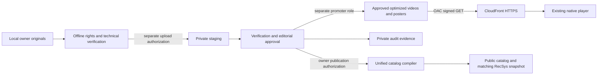

# Stage 6 — AWS media architecture

Status: local design and offline validation only. Reviewed against accepted main
`0d8893084f7ce404b08a47d940527a8f93b559d0`. No AWS deployment, media intake,
publication, push or PR is authorized. Explicit owner approval is required for
any chargeable deployment or cloud write. Stage 6 must finish with zero intentional
AWS infrastructure mutations. Account inventory is kept outside this repository.

## Architecture decision

Plan a new, dedicated general-purpose S3 bucket in Mumbai (`ap-south-1`), SSE-S3,
versioned, with all public access blocked and ACLs disabled. Start with S3 Standard.
A single CloudFront distribution uses a regional S3 REST origin, OAC, HTTPS, and
only GET/HEAD. Only `optimized/` and `posters/` are deliverable. The existing
`golixco-registration-media-*` bucket is unrelated and cannot be reused or inspected
for objects. `${MEDIA_BUCKET}` has no usable default value.

Moving an artifact into a delivery prefix exposes it through an enabled unrestricted
CDN even before a catalog entry exists. Editorial and distribution rights approval
must precede that copy. CloudFront OAC is origin protection, not viewer entitlement.
CORS also does not restrict who can download public media. Future restricted access
requires trusted key groups and signed URLs/cookies, expiration and a separate
viewer authorization design; do not merely add query tokens ignored by cache policy.

## Accepted engineering boundary

Read the hybrid roadmap and mission7 architecture, media standards and ingestion
runbook alongside the newer implementation. `docs/product/STAGE3_CATALOG_COMPILER.md`
is authoritative over older instructions to write `src/data/edits.ts` directly or
use the retired YouTube-only writer. The unified compiler validates complete
YouTube and hosted audits, exact trusted origins, video AND audio distribution
rights, source/poster/asset identity, decode and playback evidence, owner approval,
format and freshness. Private provenance does not enter public projections.
Compiled output is not proof of owner approval. Use paired frontend/snapshot
publication only during an independently authorized maintenance window.

Stages 2–5 remain untouched: source contracts, catalog transaction recovery, private
provenance, RecSys snapshot and weighted Jaccard ranking, player generation leases,
modal scopes, audio coordination, source/category feeds and demo-ID-0 featured
fallback. No schema or player change is needed to design HTTPS MP4 delivery.
Frozen demo SHA-256 remains
`43d214282ba2122c3f3b95e0c047d92027ea33f05a54f6832e17543a2e575b88`.

## Media state machine and fail-closed gates

| State/transition | Required evidence | Permission/authorization |
| --- | --- | --- |
| Owner original → locally prepared | Local backup; identity; video/audio rights review; metadata | Stage 7A scope, separately initiated |
| Prepared → private staging | SHA-256; full decode; poster; explicit upload authorization | Future staging role, no delivery rights |
| Staging → verified | Reconcile object/version/checksum with local manifest, MIME, format, duration | Verifier role or trusted offline verification |
| Verified → editorially approved | Owner approves exact content hashes, destinations and distribution rights | Private owner audit |
| Approved → deliverable | Exact approved manifest and short session scope; copy then verify | Separately authorized promoter |
| Deliverable → compiled | Complete audits, approved exact CDN origin, current playback evidence | Unified compiler dry-run/check then separately approved publication |
| Compiled → published | Paired outputs, security/CDN/browser checks, owner release approval | Authorized release process |
| Rejected/restricted | No delivery copy, quarantine evidence; preserve allocations | Owner review required before any reconsideration |

Any missing or stale gate blocks the next transition. Approval of a prefix is not
approval of every object in it. Cloud IAM cannot understand editorial approval:
manifest review and per-session object scoping are mandatory future controls.
No real media is staged, uploaded, encoded or published in Stage 6.

## Future stage handoffs

- Stage 7A: offline originals, rights/audio review, technical metadata, H.264/AAC
  faststart encodes, posters, hashes and full decode QC; no paid-cloud dependency.
- Stage 7B: separate owner authorization for a small pilot and 1–2 approved files;
  verify CDN playback, IAM denials, cost, rollback and cleanup before expansion.
- Stage 8: independent Antigravity review of 50–60 YouTube candidates toward 28
  real embeds, with metadata, embed, rights, editorial and owner gates. No final
  landscape/Shorts split is assumed. `0vswe8D3UTk` and `HoxrYzuxH_Q` remain
  shortlisted only; the eight Error-150 records remain quarantined. Duration alone
  does not classify a Short. No live YouTube calls or credentials in Stage 6.
- Stage 9: separately approved hosted intake of approximately 30 rights-cleared
  edits, final inspection, controlled promotion and unified catalog generation.

IDs: 0–16 frozen demos; 17–99 internal reserved; 100–199 YouTube landscape;
200–299 YouTube Shorts; 300–399 hosted landscape; 400–499 hosted Shorts; 500+
reserved. Allocate none now. The older fixed 60-real-item split is superseded by
this mission's provisional 28 YouTube + 30 hosted direction.

## Artifact use and remaining decisions

`templates/` contains individual AWS API/policy reference documents plus a
review-only manifest. It is deliberately not a CloudFormation/Terraform deployment
package. No renderer, credentials integration or deploy command is provided.
`node scripts/validate-stage6-infra.mjs` checks the bundle offline;
`npm test` discovers the security tests through the existing trusted isolation runner.
A release-readiness guard rejects unresolved placeholders and substituted Stage 6
bundles. AWS APIs do not enforce this local guard; a privileged human can bypass
it manually. Future deploy tooling must be independently reviewed and authorized.

Owner decisions before pilot: exact new bucket, account/distribution IDs and trusted
operators; final region and viewer geography; app origin; rights retention policy;
credit eligibility/expiry; pricing plan; pilot budget and end time; logging/WAF
spend; recovery retention. No current audit-user permission expansion is required.

Official sources and retrieval dates are linked in the companion documents.
