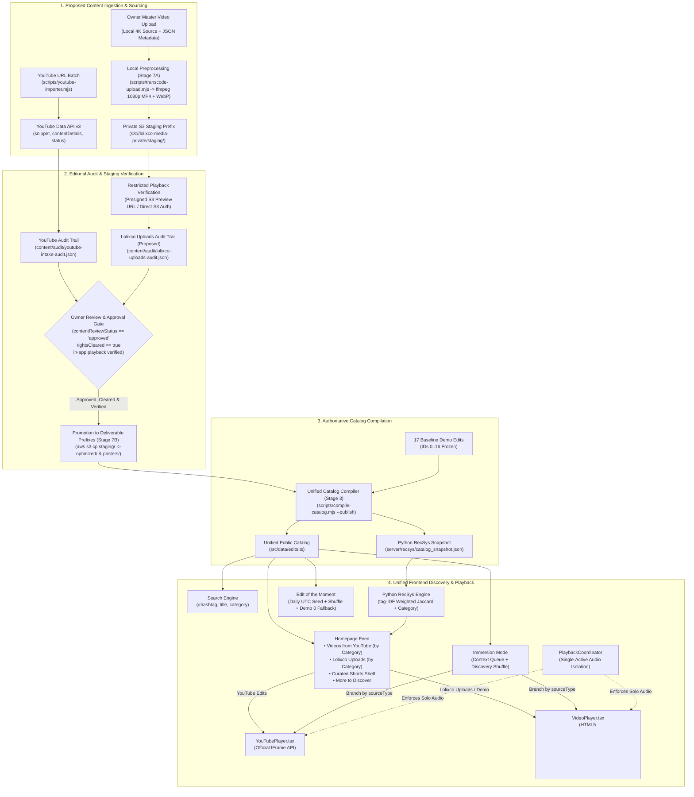

# Lolixco — Hybrid 60-Edit Platform Architecture & Implementation Roadmap

> **Document Status**: Final Architecture Specification & Implementation Roadmap (Step 1 Final Alignment)  
> **Repository Target**: `/home/vuld0/Lolixco`  
> **Branch**: `feat/mission7c-jjk-landscape-batch-01` (Commit: `4f9185c5944f18e2f225327fc27c453d7c340e84`)  
> **Audit Status**: Conditional GO for Stage 1 Only (Incorporates Codex Second Review Corrections)  
> **Operational Status**: Documentation-Only Phase — **Zero Production Content Mutation** / **Zero Application Code Changes** / **Zero Paid AWS Provisioning**  

---

## 1. Executive Summary & Product Vision

Lolixco is expanding from its 17 baseline procedural demo items ([`src/data/edits.ts`](file:///home/vuld0/Lolixco/src/data/edits.ts)) into an owner-approved **Hybrid 60-Edit Platform**. The resulting catalog will support exactly **77 total items** (17 frozen demo baselines + 60 genuine, high-impact edits) across two officially supported content sources:

1. **Videos from YouTube (30 Real Edits)**:
   - **20 Landscape Videos (16:9)**: Cinematic edits, AMVs, and gameplay sequences.
   - **10 Portrait Shorts (9:16)**: Fast-paced vertical edits with duration $\le$ 180 seconds.
   - **Technical Standard**: Official YouTube IFrame Player API ([`YouTubePlayer.tsx`](file:///home/vuld0/Lolixco/src/components/video/YouTubePlayer.tsx)). Official iframe adapter implemented; full application integration and browser verification pending.
   - **Compliance & Privacy**: Only videos confirmed embeddable through in-application testing are accepted (zero YouTube Error 150 at intake). Zero re-encoding, zero local video downloads, zero ad-stripping, and zero metric fabrication. Full attribution to original creators and channels.

2. **Lolixco Uploads (30 Real Edits)**:
   - **20 Landscape Videos (16:9)**: Creator-direct and owner-hosted high-fidelity video files.
   - **10 Portrait Shorts (9:16)**: Native portrait video files for vertical viewing.
   - **Technical Standard**: Private Amazon S3 bucket storage with secure delivery via Amazon CloudFront (Origin Access Control) and native HTML5 `<video>` playback ([`VideoPlayer.tsx`](file:///home/vuld0/Lolixco/src/components/video/VideoPlayer.tsx)).
   - **Rights Clearance & Quality**: Mandatory owner rights confirmation (`rightsCleared: true`) to distribute both video and audio. Master source archives preserved in cold/standard storage, with web-optimized 1080p H.264/AAC MP4 streaming variants.

```
                      ┌────────────────────────────────────────────────────────┐
                      │             LOLIXCO HYBRID 60-EDIT PLATFORM            │
                      │         (77 Total Items: 17 Demos + 60 Real)           │
                      └───────────────────────────┬────────────────────────────┘
                                                  │
                    ┌─────────────────────────────┴─────────────────────────────┐
                    ▼                                                           ▼
     ┌─────────────────────────────┐                             ┌─────────────────────────────┐
     │     Videos from YouTube     │                             │       Lolixco Uploads       │
     │      (30 Total Edits)       │                             │      (30 Total Edits)       │
     ├─────────────────────────────┤                             ├─────────────────────────────┤
     │ • 20 Landscape Edits (16:9) │                             │ • 20 Landscape Edits (16:9) │
     │ • 10 Portrait Shorts (9:16) │                             │ • 10 Portrait Shorts (9:16) │
     │ • YouTube IFrame Player API │                             │ • AWS S3 + CloudFront (OAC) │
     │ • Embed-verified (No E-150) │                             │ • 1080p Optimized Stream    │
     │ • Preserved Attribution     │                             │ • Confirmed Rights/Clearance│
     └─────────────────────────────┘                             └─────────────────────────────┘
```

---

## 2. 60-Edit Content Progress Tracker

This authoritative progress tracker records the current intake state. Status classifications follow strict editorial definitions:
- **Target**: Intended real edit count for release.
- **Shortlisted**: Provisionally identified candidates that passed standalone testing but await formal in-app player integration testing and owner authorization.
- **Approved**: Verified through the Lolixco application player, taxonomy-checked, format-confirmed, rights-cleared (for uploads), and authorized by the owner in private audit files.
- **Compiled**: Validated and compiled into [`src/data/edits.ts`](file:///home/vuld0/Lolixco/src/data/edits.ts) with zero private metadata leaks by the authoritative unified compiler.
- **Published / Deployed**: Verified in production build artifacts (`dist/`) and live on the web for visitors.
- **Remaining to Source**: Genuine edits required to reach the 60-edit target.

### 2.1 Content Sourcing Status Table

| Source / Format | Target | Shortlisted | Approved | Compiled | Published | Remaining to Source |
| :--- | :---: | :---: | :---: | :---: | :---: | :---: |
| **YouTube Landscape** | 20 | 2 | 0 | 0 | 0 | 18 |
| **YouTube Shorts** | 10 | 0 | 0 | 0 | 0 | 10 |
| **Lolixco Landscape** | 20 | 0 | 0 | 0 | 0 | 20 |
| **Lolixco Shorts** | 10 | 0 | 0 | 0 | 0 | 10 |
| **TOTAL** | **60** | **2** | **0** | **0** | **0** | **58** |

### 2.2 Shortlisted YouTube Candidates (Mission 7C Verification)

Two Jujutsu Kaisen landscape edits were provisionally verified as playable during Mission 7C local standalone browser testing:

| Candidate ID | Video ID | Canonical URL | Title | Duration | Category / Fandom | Current Verification Status |
| :--- | :--- | :--- | :--- | :---: | :--- | :--- |
| **C-01** | `0vswe8D3UTk` | [https://youtu.be/0vswe8D3UTk](https://youtu.be/0vswe8D3UTk) | a very normal TOJI edit [AMV] (Jujutsu Kaisen) Blu-Ray | 2:16 | Anime / `jujutsu-kaisen` | Shortlisted (Reported Standalone OK; requires in-app player test) |
| **C-02** | `HoxrYzuxH_Q` | [https://youtu.be/HoxrYzuxH_Q](https://youtu.be/HoxrYzuxH_Q) | Jujutsu Kaisen - Neon Blade [Edit/AMV] | 0:39 | Anime / `jujutsu-kaisen` | Shortlisted (Reported Standalone OK; requires in-app player test) |

> [!IMPORTANT]
> **Provisional Shortlist Governance**: Neither candidate is approved or compiled into production. They will only be promoted to **Approved** after passing automated player lifecycle tests inside [`YouTubePlayer.tsx`](file:///home/vuld0/Lolixco/src/components/video/YouTubePlayer.tsx) and receiving explicit owner sign-off.

### 2.3 Quarantined Mission 7C Candidates (Reported Error 150)

The remaining eight original candidates from batch `jjk-landscape-batch-01` reportedly failed embedded playback with YouTube Player Error 150:

- `44pt8w67S8I`
- `qF0PdgefNMY`
- `Cu4Wr0b2BdA`
- `TgZOhm9Q_IY`
- `dbPHCjZ-lHw`
- `B3j9ithaRtE`
- `VR95kfx9JRY`
- `H1Q5zPXbefU`

> [!CAUTION]
> **Quarantine Rule & Error 150 Definition**: These eight video IDs are barred from the public catalog. Their private intake audit records remain preserved in the audit trail with status `embed_restricted`, denoting candidates whose upstream YouTube Data API metadata indicates public availability, but which fail in-app embedded player playback due to content owner or third-party embedding restrictions. They do not count toward the 60-video quota. Zero Error 150 is an intake acceptance gate, not a permanent guarantee against future third-party restriction.

---

## 3. Independent Codex Audit Findings Disposition

Codex completed two independent architecture audits. Below is the technical disposition of all findings evaluated against the active Linux repository and branch [`feat/mission7c-jjk-landscape-batch-01`](file:///home/vuld0/Lolixco):

| ID | Finding | Classification | Status & Resolution in this Roadmap |
| :--- | :--- | :---: | :--- |
| **B1** | Proposed public schema exposes private `masterAssetRef` | **Confirmed (Roadmap Defect)** | **Fixed in Roadmap (§6.2)**: Removed `masterAssetRef` and internal S3 paths from `PublicEdit`. Private keys and rights documentation are strictly confined to private audit files. |
| **B2** | Native video `useEffect` in [`VideoPlayer.tsx`](file:///home/vuld0/Lolixco/src/components/video/VideoPlayer.tsx) crashes on YouTube hero | **Confirmed (Source Defect)** | **Scheduled for Fix (Stage 4)**: Identified null dereference on line 52 (`video.current!`). Stage 4 isolates native player effects and mandates in-app hero mounting tests. |
| **B3** | RecSys schema drift check and runtime loader omit channel metadata | **Confirmed (Source Inconsistency)** | **Scheduled for Fix (Stage 3)**: Four-point alignment across `export_catalog.py` allowlist, drift comparison, `catalog.py` runtime loader, and `EditItem` dataclass. |
| **B4** | Validation engine [`validate-content.mjs`](file:///home/vuld0/Lolixco/scripts/validate-content.mjs) rejects IDs $\ge 300$ | **Confirmed (Source Inflexibility)** | **Scheduled for Fix (Stage 2)**: Extended validation bounds for all five partitions: `0–16` (Demo), `17–99` (Reserved), `100–199` (YT Video), `200–299` (YT Short), `300–399` (Hosted Video), `400–499` (Hosted Short). |
| **B5** | YouTube compiler [`compile-youtube-catalog.mjs`](file:///home/vuld0/Lolixco/scripts/compile-youtube-catalog.mjs) would discard hosted records | **Confirmed (Source Hazard)** | **Scheduled for Fix (Stage 3)**: Replaces single-source compilation with an authoritative unified compiler (`scripts/compile-catalog.mjs`). Retires older compiler to prevent accidental overwrites. |
| **B6** | S3 bucket layout fails to isolate raw 4K masters from CloudFront OAC | **Confirmed (Security Architecture Flaw)** | **Fixed in Roadmap (§7.1)**: Defined 6-step promotion workflow (`staging/` $\to$ restricted verification $\to$ owner approval $\to$ `optimized/`). S3 bucket policy scopes OAC access strictly to `/optimized/*` and `/posters/*`. |
| **I1** | Documented commands and filenames do not match repository | **Confirmed** | **Fixed in Roadmap (§5, §9)**: Explicitly labeled `compile-catalog.mjs`, `upload-importer.mjs`, and `--disable-hosted` as **Proposed**. Documented actual RecSys snapshot commands (`python3 -m server.recsys.export_catalog`). |
| **I2** | Audio coordination is only partial (native player unintegrated) | **Confirmed** | **Fixed in Roadmap (§5, §11)**: Replaced "100% ready" claims with "Partial integration; lifecycle verification required". Stage 4 registers native player and tests rapid navigation. |
| **I3** | CloudFront playback does not require quality-tier schema | **Confirmed** | **Fixed in Roadmap (§5)**: Clarified that native player already handles direct URLs. The work is delivery verification (range requests, CORS, MIME). Preserved relative URLs for demos. |
| **I4** | Homepage category subheadings omitted from feed composition | **Confirmed** | **Fixed in Roadmap (§8.1)**: Stage 5 specifies source $\to$ populated category rows, deduplication rules, and empty-section handling while preserving demo access. |
| **I5** | Edit of the Moment fallback logic described incorrectly | **Confirmed** | **Fixed in Roadmap (§8.1)**: Defined pool as approved real landscape edits from *both* sources. If empty, explicitly defaults to demo ID 0 ("Into the Light"). Private drafts never selected. |
| **I6** | RecSys is tag-IDF weighted Jaccard, not TF-IDF / cosine | **Confirmed** | **Fixed in Roadmap (§9.2)**: Corrected technical description to match [`similarity.py`](file:///home/vuld0/Lolixco/server/recsys/similarity.py) (tag-IDF weighted Jaccard + category matching + session affinity). |
| **I7** | API key loading on import couples tests to workstation `.env.local` | **Partially Confirmed & Clarified** | **Scheduled for Fix (Stage 1)**: Local commits `5052991` & `4f9185c` added offline HTTP stubs, but formal fail-closed test isolation is scheduled as Stage 1. |
| **I8** | Discrepancy between `reviewStatus` and `contentReviewStatus` | **Confirmed** | **Fixed in Roadmap (§6.3, §10)**: Unified on `contentReviewStatus` lifecycle including `embed_restricted`. Separated API embeddability from application browser playback verification evidence. |
| **I9** | 10-year credit runway claim misrepresents AWS terms | **Confirmed** | **Fixed in Roadmap (§7.2)**: Removed 10-year claim. Highlighted credit expiration windows (6–12 months) and advised owner verification in AWS console. |
| **I10** | Cost model mixed pricing plans and understated video sizes | **Confirmed** | **Fixed in Roadmap (§7.2)**: Documented realistic file sizes (~71 MB for 136s 1080p @ 4 Mbps). Clarified CloudFront pay-as-you-go free tier vs flat-rate constraints and regional pricing. |
| **I11** | Glacier Instant Retrieval has minimum durations & retrieval fees | **Confirmed** | **Fixed in Roadmap (§7.1)**: Recommended S3 Standard for initial intake ($0.28/mo difference) or documented Glacier retrieval costs ($0.03/GB) and 90-day retention. |
| **I12** | `--disable-hosted` and AWS Budgets are not instantaneous kill-switches | **Confirmed** | **Fixed in Roadmap (§7.2)**: Separated catalog discovery rollback from actual CDN distribution shutdown in AWS console. Noted distribution propagation delays and AWS Budgets latency. |
| **I13** | Seeking, Shorts completion, badges, and routing need tightening | **Confirmed** | **Fixed in Roadmap (§8.2, §11)**: Noted range-request verification (not guaranteed "instant"), query-based routing (`?view=shorts`), source badges, and loop/advance alignment. |

---

## 4. Architecture & Data-Flow Diagram

The hybrid architecture ensures that diverse content origins (YouTube vs. AWS S3/CloudFront) converge into a single unified metadata catalog, while utilizing source-specialized player adapters.



---

## 5. Current Implementation Inventory vs. Proposed Additions

| Subsystem / File | Current Repository Status | Hybrid Gaps & Required Actions |
| :--- | :---: | :--- |
| **Catalog Types**<br>[`src/types/content.ts`](file:///home/vuld0/Lolixco/src/types/content.ts) | Partial | Declares `VideoSourceType`. **Action**: Update `PublicMediaMetadata` to formally support CloudFront URLs for hosted media while preserving relative URLs for demo items. Strictly bar private keys (`masterAssetRef`). |
| **Live Catalog**<br>[`src/data/edits.ts`](file:///home/vuld0/Lolixco/src/data/edits.ts) | Complete (Demo) | 17 baseline demo edits (IDs `0–16`). **Action**: Preserve `0–16` intact. Support compiled entries up to ID 499. |
| **Taxonomy & Fandoms**<br>[`src/data/fandoms.ts`](file:///home/vuld0/Lolixco/src/data/fandoms.ts) | Complete | 6 canonical categories + legacy `Cinematic`. `FANDOM_REGISTRY` with 5 registered fandoms. **100% compatible**. |
| **Feed Composition**<br>[`src/data/feedComposition.ts`](file:///home/vuld0/Lolixco/src/data/feedComposition.ts) | Partial | Builds Recommended Edits, Curated Shorts, More to Discover. **Gap**: Lacks source partitioning and category sub-rows. |
| **Featured Player**<br>[`src/components/video/VideoPlayer.tsx`](file:///home/vuld0/Lolixco/src/components/video/VideoPlayer.tsx) | Defective on Hero Mount | **B2 Defect**: Null dereference in `useEffect` when YouTube hero is active. Native `<video>` hardcodes demo copy. **Action**: Guard lifecycle; generalize metadata display. |
| **YouTube Player**<br>[`src/components/video/YouTubePlayer.tsx`](file:///home/vuld0/Lolixco/src/components/video/YouTubePlayer.tsx) | Partial Integration | Official iframe adapter implemented; full application integration and browser verification pending. |
| **Shorts Viewer**<br>[`src/components/shorts/ShortsViewer.tsx`](file:///home/vuld0/Lolixco/src/components/shorts/ShortsViewer.tsx) | Partial | Branches to YouTube or native `<video>`. **Gap**: Native branch loops, while YouTube branch advances on end. Native `onPlay` does not notify coordinator. |
| **Immersion Mode**<br>[`src/components/immersion/ImmersionViewer.tsx`](file:///home/vuld0/Lolixco/src/components/immersion/ImmersionViewer.tsx) | Complete | Opening queue (up to 3 items) + discovery shuffle. Source-aware branching implemented; browser verification pending. |
| **Edit of the Moment**<br>[`src/utils/editOfTheMoment.ts`](file:///home/vuld0/Lolixco/src/utils/editOfTheMoment.ts) | Partial | Deterministic UTC daily seed. **Gap**: Selects only YouTube embeds; falls back to rotating landscape rather than explicitly choosing Demo 0. Private drafts must never be selected. |
| **Audio Coordinator**<br>[`src/utils/playbackCoordinator.ts`](file:///home/vuld0/Lolixco/src/utils/playbackCoordinator.ts) | Partial Integration | Coordinates registered players. **Gap**: Native `VideoPlayer` never registers; native Shorts viewer does not reclaim ownership. Lifecycle verification required. |
| **Python RecSys**<br>[`server/recsys/`](file:///home/vuld0/Lolixco/server/recsys/) | Schema Inconsistency | **B3 Defect**: `export_catalog.py` allowlist & drift check, and `catalog.py` runtime loader reject channel metadata. Algorithm is tag-IDF Jaccard. |
| **Validation Engine**<br>[`scripts/validate-content.mjs`](file:///home/vuld0/Lolixco/scripts/validate-content.mjs) | Range Inflexibility | **B4 Defect**: Rejects video IDs outside `100–199` and shorts outside `200–299`. Must be extended for hosted IDs `300–499`. |
| **YouTube Pipeline**<br>[`scripts/youtube-*.mjs`](file:///home/vuld0/Lolixco/scripts/) | Complete (YT Only) | Importer, review CLI, and compiler. **B5 Hazard**: Compiler overwrites `edits.ts` without hosted awareness. Must be retired in favor of unified compiler. |
| **Hosted Pipeline**<br>(`scripts/upload-*.mjs`) | **Proposed / Not Implemented** | Does not exist. Needs `upload-importer.mjs`, `review-upload-batch.mjs`, and `transcode-upload.mjs`. |

---

## 6. Source-Aware Catalog Schema & Non-Overlapping ID Allocations

### 6.1 Non-Overlapping ID Partitions

```
[0 ────── 16]   Baseline Demo Edits (17 Items) ────────────────────────── [FROZEN]
[17 ───── 99]   Internal Test Fixtures & Negative Testing ─────────────── [RESERVED]
[100 ──── 199]  Curated YouTube Landscape Edits (Target: 20, Capacity: 100)
[200 ──── 299]  Curated YouTube Portrait Shorts (Target: 10, Capacity: 100)
[300 ──── 399]  Lolixco-Hosted Landscape Edits (Target: 20, Capacity: 100)
[400 ──── 499]  Lolixco-Hosted Portrait Shorts (Target: 10, Capacity: 100)
[500+]          Reserved for Future Platform Expansion
```

### 6.2 Proposed Public Catalog TypeScript Contract (`Proposed: src/types/content.ts`)

> [!IMPORTANT]
> **Confidentiality Enforcement (Fix for B1)**: `masterAssetRef`, internal S3 paths, raw asset hashes, rights clearance documents, and approval notes are strictly excluded from the public `PublicEdit` interface and client bundles. The compiler will enforce an explicit runtime field allowlist.

```typescript
export type ContentFormat = "video" | "short";

export type VideoSourceType =
  | "local_demo"            // Procedural motion study (IDs 0-16)
  | "youtube_embed"         // YouTube IFrame Player (IDs 100-299)
  | "licensed_local_media";  // Lolixco CloudFront Uploads (IDs 300-499)

export interface PublicEdit {
  id: number;                        // Non-overlapping ID within designated partition
  title: string;                     // Curated display title
  category: CanonicalCategory | LegacyCategory; // Canonical category taxonomy
  tags: string[];                    // Lowercase keywords & #hashtags
  description: string;               // Clean editorial synopsis
  creator: string;                   // Attributed creator name or channel
  poster: string;                    // HTTPS URL (CloudFront/YouTube) or relative URL for demo baseline
  source: string;                    // CloudFront video URL, YouTube watch URL, or relative demo path
  duration: string;                  // Format: "m:ss"
  trending: boolean;                 // Curated trending flag
  format: ContentFormat;             // "video" (16:9) or "short" (9:16)
  fandomIds?: string[];              // Registered slugs in FANDOM_REGISTRY
  sourceType: VideoSourceType;
  
  // YouTube-Specific Public Metadata (Mandatory when sourceType === "youtube_embed")
  youtubeVideoId?: string;           // Exactly 11 characters
  channelTitle?: string;             // Original YouTube channel label
  channelId?: string;                // Canonical UC... channel ID
  sourceUrl?: string;                // Canonical watch link
}
```

#### Field Enforcement Rules by Source Type
1. **`sourceType === "youtube_embed"`**:
   - `youtubeVideoId` is required (regex: `^[A-Za-z0-9_-]{11}$`).
   - `channelTitle`, `channelId`, and `sourceUrl` are required.
   - `poster` must be an HTTPS URL (typically `i.ytimg.com` thumbnail).
   - `source` must be the canonical watch URL.
2. **`sourceType === "licensed_local_media"`**:
   - `source` must be an absolute HTTPS CloudFront URL pointing to the `/optimized/*` prefix (e.g., `https://cdn.lolixco.com/optimized/landscape/edit-300-1080p.mp4`).
   - `poster` must be an absolute HTTPS CloudFront URL pointing to the `/posters/*` prefix (e.g., `https://cdn.lolixco.com/posters/landscape/edit-300-poster.webp`).
   - Private S3 identifiers and credentials must be absent.
3. **`sourceType === "local_demo"`**:
   - Permitted only for IDs `0–16`.
   - Relative paths permitted for `source` and `poster` (preserving baseline demo behavior).

### 6.3 Proposed Private Editorial Audit Record Schema (`Proposed: content/audit/*.json`)

Internal provenance, storage keys, and rights metadata are maintained exclusively within private, git-ignored audit stores (`content/audit/youtube-intake-audit.json` and `content/audit/lolixco-uploads-audit.json`):

```typescript
export interface PrivateAuditRecord {
  assignedLolixcoId: number;
  sourceType: VideoSourceType;
  format: ContentFormat;
  formatConfirmed: boolean;
  contentReviewStatus: 
    | "submitted"           // Raw candidate URL or local video path registered
    | "metadata_collected"  // Technical metadata extracted via API or ffprobe
    | "needs_review"        // Awaiting manual inspection of taxonomy & content
    | "embed_eligible"      // YouTube API indicates embeddable (pre-player check)
    | "embed_restricted"    // Quarantined: failed in-app playback with Error 150
    | "approved"            // Verified in player, rights-cleared, signed off by owner
    | "compiled"            // Included in local src/data/edits.ts by compiler
    | "published"           // Verified live in production web deployment
    | "rejected"            // Declined by owner or editorial review
    | "unavailable";        // Upstream video deleted, privated, or blocked
  
  // Technical Provenance & Assets (Strictly Private - Excluded from Public Output)
  provenance: "youtube_data_api_v3" | "owner_direct_upload";
  rightsCleared: boolean;            // Mandatory true for hosted publication
  rightsClearanceDocumentation?: string; // Document ID, license agreement, or author consent record
  s3MasterArchiveKey?: string;       // e.g. "masters/landscape/source-4k-edit-01.mov"
  s3StagingKey?: string;             // e.g. "staging/landscape/edit-300-preview.mp4"
  s3OptimizedKey?: string;           // e.g. "optimized/landscape/edit-300-1080p.mp4"
  mediaInspection?: {
    codec: string;
    audioCodec: string;
    width: number;
    height: number;
    frameRate: number;
    durationSec: number;
  };
  inAppPlaybackVerifiedAt?: string;  // RFC3339 timestamp of successful in-app playback test
  internalNotes?: string;            // Private curator commentary
}
```

---

## 7. Secure AWS S3 & CloudFront Architecture

```
┌────────────────────────────────────────────────────────────────────────────────────────┐
│                        SECURE PROMOTION-BASED AWS ARCHITECTURE                         │
└────────────────────────────────────────────────────────────────────────────────────────┘

 [Owner Workstation]
        │
        │ 1. Local ffmpeg Transcode (1080p Web-Optimized MP4 + WebP Poster)
        │ 2. Authenticated AWS CLI PUT to /staging/ (Owner IAM credentials)
        ▼
 ┌───────────────────────────────────────────────────────────────────────┐
 │               Private Amazon S3 Bucket (Private Origin)               │
 │                     (s3://lolixco-media-private/)                     │
 ├───────────────────────────────────────────────────────────────────────┤
 │ • Block All Public Access = ENABLED                                   │
 │ • Default Encryption = SSE-S3                                         │
 │                                                                       │
 │ [PRIVATE ONLY - BARRED BY S3 BUCKET POLICY FROM CLOUDFRONT]           │
 │ ├── /masters/       (Raw 4K Source Archives - S3 Standard)            │
 │ └── /staging/       (Unapproved Draft Uploads)                        │
 │                                                                       │
 │       │                                                               │
 │       │ 3. Restricted In-App Playback Verification (Presigned URL)    │
 │       │ 4. Owner Review & Rights Clearance Approval                   │
 │       │ 5. Explicit S3 Promotion Copy (Authorized Role Only)          │
 │       ▼                                                               │
 │                                                                       │
 │ [PUBLICLY DELIVERABLE - SCOPED S3 BUCKET POLICY GRANTS CLOUDFRONT OAC]│
 │ ├── /optimized/     (Web-Optimized 1080p H.264/AAC MP4 Files)        │
 │ └── /posters/       (WebP / JPEG Thumbnail Posters)                   │
 └───────────────────────────────────┬───────────────────────────────────┘
                                     │
                                     │ Origin Access Control (OAC)
                                     │ S3 Bucket Policy allows s3:GetObject ONLY on
                                     │ arn:aws:s3:::lolixco-media-private/optimized/*
                                     │ and arn:aws:s3:::lolixco-media-private/posters/*
                                     ▼
 ┌───────────────────────────────────────────────────────────────────────┐
 │                        Amazon CloudFront CDN                          │
 │                       (https://cdn.lolixco.com)                       │
 │                   [CDN ROUTING RESPONSIBILITY ONLY]                   │
 ├───────────────────────────────────────────────────────────────────────┤
 │ • Origin: s3://lolixco-media-private with OAC (Origin Path = root)    │
 │ • Default Cache Behavior: Forwards GET/HEAD with Range headers to S3  │
 │ • Requests for /masters/* or /staging/* reach S3 -> S3 DENIES (403)   │
 │ • HTTPS Only (TLS 1.3)                                                │
 │ • CORS: Access-Control-Allow-Origin: https://lolixco.com              │
 └───────────────────────────────────┬───────────────────────────────────┘
                                     │
                                     ▼
                         [Visitor VideoPlayer.tsx]
```

### 7.1 Complete Approval-Before-Public-Delivery Security Workflow (Fix for B6)

Security enforcement is achieved through explicit architectural separation between upload permissions, storage access, delivery authorization, and CDN routing:

#### 1. The Strict 6-Step Promotion Sequence
Every hosted asset must traverse this sequential verification and promotion pipeline before becoming deliverable to the public:
```
Private S3 staging → restricted playback verification → owner approval → promotion into publicly deliverable optimized/poster prefixes → catalog compilation → authorized deployment
```
- **Step 1: Private S3 Staging**: Transcoded media is uploaded strictly to `s3://lolixco-media-private/staging/`.
- **Step 2: Restricted Playback Verification**: The owner verifies audio/video playback and range seeking using short-lived AWS IAM presigned URLs (`aws s3 presign ...`) or direct authenticated S3 API access. Unapproved videos are **never accessible through CloudFront**.
- **Step 3: Owner Approval**: The owner reviews metadata, inspects technical properties, and confirms rights clearance (`contentReviewStatus: "approved"`, `rightsCleared: true`).
- **Step 4: Explicit Promotion**: An authorized operator role executes an explicit copy:
  ```bash
  aws s3 cp s3://lolixco-media-private/staging/edit-300-1080p.mp4 s3://lolixco-media-private/optimized/landscape/edit-300-1080p.mp4
  aws s3 cp s3://lolixco-media-private/staging/edit-300-poster.webp s3://lolixco-media-private/posters/landscape/edit-300-poster.webp
  ```
- **Step 5: Catalog Compilation**: The unified catalog compiler verifies that the promoted files exist in the deliverable prefixes, then writes the public CloudFront URLs into [`src/data/edits.ts`](file:///home/vuld0/Lolixco/src/data/edits.ts) (`contentReviewStatus: "compiled"`).
- **Step 6: Authorized Deployment**: The updated application bundle is deployed to production with owner authorization (`contentReviewStatus: "published"`).

#### 2. Clear Responsibility Matrix: IAM, S3 Bucket Policy, OAC & CDN Routing
- **Workstation Uploader IAM Role**:
  - Permissions strictly scoped to `s3:PutObject` on `staging/*` and `masters/*`.
  - Strictly **denied** permission to write to `optimized/*` or `posters/*`. This prevents accidental direct uploads into deliverable paths.
- **Authoritative S3 Bucket Policy**:
  - Rejects all direct public internet access (`BlockPublicAcls`, `IgnorePublicAcls`, `BlockPublicPolicy`, `RestrictPublicBuckets` all `true`).
  - Grants `s3:GetObject` **exclusively** to the CloudFront Origin Access Control (OAC) principal.
  - The resource permission is strictly restricted to public delivery prefixes:
    ```json
    {
      "Version": "2012-10-17",
      "Statement": [
        {
          "Sid": "AllowCloudFrontOACReadOnlyOptimizedAndPosters",
          "Effect": "Allow",
          "Principal": {
            "Service": "cloudfront.amazonaws.com"
          },
          "Action": "s3:GetObject",
          "Resource": [
            "arn:aws:s3:::lolixco-media-private/optimized/*",
            "arn:aws:s3:::lolixco-media-private/posters/*"
          ],
          "Condition": {
            "StringEquals": {
              "AWS:SourceArn": "arn:aws:cloudfront::<ACCOUNT_ID>:distribution/<DISTRIBUTION_ID>"
            }
          }
        }
      ]
    }
    ```
- **CloudFront Origin Access Control (OAC)**:
  - Cryptographically signs requests forwarded from CloudFront to S3 using AWS SigV4, verifying that requests originate from the designated Lolixco CloudFront distribution.
- **CloudFront CDN Routing vs. Security Responsibilities**:
  - CloudFront cache behaviors are **routing and delivery optimizations**, **NOT security deny rules**.
  - CloudFront routes incoming HTTP/HTTPS requests to the origin, caches responses, forwards HTTP `Range` headers for seeking, enforces TLS 1.3, and adds CORS headers.
  - Security denial is enforced entirely by Amazon S3: if a user or script requests `https://cdn.lolixco.com/masters/...` or `https://cdn.lolixco.com/staging/...`, CloudFront routes the request to S3, and **S3 returns HTTP 403 Forbidden** because the bucket policy does not permit `s3:GetObject` on those paths.

#### 3. Storage Tiering (Fix for I11)
- Initial intake of 30 masters (~15–20 GB) will use **S3 Standard** in `us-east-1` ($0.35–$0.46/mo total).
- Avoids Glacier Instant Retrieval minimum 90-day storage charges, retrieval fees ($0.03/GB), and early-deletion penalties while batches are actively curated and transcoded.

### 7.2 Realistic Cost Modeling & Credit Terms (Fix for I9, I10, I12)

- **Regional Assumptions**: All pricing calculations assume deployment in the **`us-east-1` (US East, N. Virginia)** AWS region.
- **Credit Expiration Risks**: AWS Promotional Credits carry strict expiration dates (typically 6 to 12 months from issuance). Promotional credits do not provide a multi-year runway. The owner must inspect the AWS Billing and Cost Management console to record the exact expiration date and eligible services.
- **Realistic File Sizing**:
  - A 136-second 1080p landscape edit encoded at 4000 kbps (H.264 High Profile) with 192 kbps AAC audio produces a file size of **~71 MB** (plus container overhead).
  - 20 landscape edits (~1.4 GB) + 10 vertical shorts (~350 MB) = **~1.75 GB optimized streaming storage**.
- **Comprehensive Cost Components**:
  - *Data Transfer Out (Egress)*: Under CloudFront's Always Free Tier, the first **1 TB of outbound data transfer per month is free**. 1 TB covers approximately **14,000 full playbacks** of 71 MB landscape edits per month. Beyond 1 TB, standard regional rates apply ($0.085/GB in `us-east-1`).
  - *HTTP/HTTPS Request Fees*: CloudFront free tier includes 10,000,000 HTTP/HTTPS requests/month ($0.0075 per 10,000 requests thereafter).
  - *S3 Request Costs*: S3 Tier 1 (PUT) is $0.005 per 1,000 requests; S3 Tier 2 (GET) is $0.0004 per 1,000 requests.
  - *CloudFront Invalidations*: The first 1,000 invalidation paths per month are free ($0.005 per path thereafter).
  - *Logging Costs*: CloudFront standard access logs to S3 incur minimal S3 PUT and storage fees ($0.023/GB); CloudWatch real-time log streaming incurs $0.50/GB ingested if enabled.
- **Emergency Shutdown vs. Catalog Discovery Rollback (Fix for I12)**:
  - *Immediate Catalog Discovery Rollback*: The proposed `--disable-hosted` compiler flag removes hosted items from [`src/data/edits.ts`](file:///home/vuld0/Lolixco/src/data/edits.ts). This takes effect immediately upon deploying the frontend bundle.
  - *True CDN Edge Shutdown & Propagation Delays*: Disabling an Amazon CloudFront distribution (`Enabled: false` in AWS Console or CLI) initiates a global configuration update across hundreds of edge locations. **Propagation takes 5 to 15+ minutes** to complete globally. Edge caches may continue serving existing cached objects until propagation finishes.
  - *AWS Budgets*: Automated billing alerts will be configured at $5.00, $8.00, and $10.00. AWS Budgets provide rapid notification, not instant hard spending cutoffs.

---

## 8. Homepage & Shorts Layout Plan

### 8.1 Dual Source Sections with Category Hierarchy (Fix for I4, I5)

The home feed layout organizes content by source while grouping items by canonical category:

```
┌────────────────────────────────────────────────────────────────────────┐
│ [HEADER]: Global Search (#tags, title) | Category Filter Chips         │
├────────────────────────────────────────────────────────────────────────┤
│ [HERO BANNER]: EDIT OF THE MOMENT                                      │
│ • Deterministic daily rotation across all approved landscape edits     │
│ • Both YouTube and Lolixco Uploads eligible                            │
│ • Explicit fallback to Demo ID 0 ("Into the Light") if 0 approved      │
│ • Private drafts and unapproved uploads are strictly barred            │
│ • Accessible [Shuffle] button for instant catalog exploration          │
├────────────────────────────────────────────────────────────────────────┤
│ [UP NEXT / SIDEBAR] (Desktop view alongside hero player)               │
├────────────────────────────────────────────────────────────────────────┤
│ [SECTION 1]: VIDEOS FROM YOUTUBE (Landscape Row)                       │
│ • Subheadings / grouping: Anime, Movies, Gaming, Phonk, Series         │
│ • Channel attribution & duration badges                                │
├────────────────────────────────────────────────────────────────────────┤
│ [SECTION 2]: CURATED SHORTS (Horizontal Shelf)                         │
│ • Unified portrait cards from YouTube (200-299) & Uploads (400-499)    │
│ • Source badges: 'YouTube Short' vs 'Lolixco'                          │
├────────────────────────────────────────────────────────────────────────┤
│ [SECTION 3]: LOLIXCO UPLOADS (Landscape Row)                           │
│ • Subheadings / grouping: Anime, Phonk, Gaming, Multifandom            │
│ • Direct CloudFront streaming with byte-range scrubbing                │
├────────────────────────────────────────────────────────────────────────┤
│ [SECTION 4]: MORE TO DISCOVER (Recommendation Backfill)                │
│ • Personalized discovery powered by Python RecSys                      │
└────────────────────────────────────────────────────────────────────────┘
```

#### Edit of the Moment Invariants
1. **Candidate Pool**: Only approved, compiled landscape edits currently present in [`src/data/edits.ts`](file:///home/vuld0/Lolixco/src/data/edits.ts) (`sourceType === "youtube_embed"` or `"licensed_local_media"`, with `format === "video"`).
2. **Draft & Staging Exclusion**: Private intake drafts, quarantined entries (`embed_restricted`), and unapproved staging files are never compiled into the frontend bundle and can never be selected.
3. **Deterministic Seed**: Seeded by the current UTC date string (`YYYY-MM-DD`), ensuring identical daily selection for all users globally.
4. **Zero-Approved Fallback**: If the pool contains zero approved real landscape edits (as during initial development), the selector explicitly and deterministically returns **Demo ID 0 ("Into the Light")**.

### 8.2 Dedicated Shorts Viewer & Query Routing (Fix for I13)

- **Routing**: Accessed via query parameter (`?view=shorts` or clicking any portrait card).
- **Player Lifecycle**:
  - `YouTubePlayer` mounts for `youtube_embed` records (9:16 aspect ratio).
  - Native `<video>` mounts for `licensed_local_media` records.
  - **Completion Alignment**: Both player adapters advance to the next Short upon playback completion (`onEnded`), with an explicit loop toggle for user control.
- **Audio Coordination**: Opening the Shorts viewer triggers `playbackCoordinator.notifyPlaying("shorts-viewer")`, cleanly pausing any active background player.

---

## 9. Search, Recommendation & Immersion Integration Contracts

### 9.1 Unified Search Engine Contract

[`src/data/searchEngine.ts`](file:///home/vuld0/Lolixco/src/data/searchEngine.ts) evaluates queries uniformly across all items:
- **Hashtag Search (`#tag`)**: Matches `tags` arrays matching `#anime`, `#jjk`, `#phonk`, `#4k`.
- **Text Search**: Matches against `title`, `category`, and `description`.
- **Privacy Rule**: Creator metadata weight remains strictly `0.00` in public search results.
- **Format Splitting**: `splitMixedResults` separates mixed matches into landscape videos and portrait shorts without altering relevance ranking.

### 9.2 Python Recommendation Engine Contract (Fix for B3, I6)

The recommendation engine in [`server/recsys/`](file:///home/vuld0/Lolixco/server/recsys/) operates on explicit algorithm contracts:
- **Actual Algorithm**: **Tag-IDF weighted Jaccard similarity** (ignoring boilerplate tags like `original` and `demo`), combined with category matching scores and session watch history affinity.
- **Four-Point Schema Alignment (Fix for B3)**:
  1. [`export_catalog.py`](file:///home/vuld0/Lolixco/server/recsys/export_catalog.py): Add `channelTitle`, `channelId`, `sourceUrl` to `ALLOWED_RECORD_FIELDS`.
  2. `export_catalog.py`: Update the exact drift comparison field list.
  3. [`catalog.py`](file:///home/vuld0/Lolixco/server/recsys/catalog.py): Update the runtime loader allowlist to accept channel metadata without throwing unexpected field errors.
  4. [`types.py`](file:///home/vuld0/Lolixco/server/recsys/types.py): Update the `EditItem` dataclass to include optional channel metadata.
- **Snapshot Execution**:
  - Export snapshot: `python3 -m server.recsys.export_catalog`
  - Read-only drift verification: `python3 -m server.recsys.export_catalog --check`

### 9.3 Immersion Mode Contract

[`ImmersionViewer.tsx`](file:///home/vuld0/Lolixco/src/components/immersion/ImmersionViewer.tsx) provides continuous viewing:
1. **Opening Stage**: Up to 3 distinct items matching entry context from either source.
2. **Discovery Stage**: Seamless transition into a shuffled pool across all eligible categories.
3. **Player Handoff**: Loads `YouTubePlayer` or native `<video>` depending on `sourceType`, without resetting the queue index.
4. **Auto-Advance**: Advances to next item upon either YouTube `ENDED` (state 0) or HTML5 video `onEnded`.
5. **Bounded Error Recovery**: Automatically skips unplayable items up to 3 consecutive times.

---

## 10. Content Approval Workflow & Fail-Closed Compilation Architecture

### 10.1 Publication Invariants
Every real edit published to production must satisfy:
1. **Valid Metadata**: Explicit non-empty title, category in `CANONICAL_CATEGORIES`, valid duration (`m:ss`), and clean description.
2. **Registered Fandom**: If associated with a fandom, slug must exist in `FANDOM_REGISTRY` in [`src/data/fandoms.ts`](file:///home/vuld0/Lolixco/src/data/fandoms.ts).
3. **In-App Playback Evidence**:
   - YouTube: Tested through [`YouTubePlayer.tsx`](file:///home/vuld0/Lolixco/src/components/video/YouTubePlayer.tsx) (no Error 150).
   - Hosted: Tested on CloudFront; audio/video decodable with valid codecs and range seeking.
4. **Attribution & Rights**:
   - YouTube: Verified channel title, channel ID, and canonical watch URL.
   - Hosted: Documented rights clearance (`rightsCleared: true`).

### 10.2 Authoritative Unified Compilation & Fail-Closed Publication Architecture (Fix for B5)

The catalog compilation pipeline must guarantee that public releases are safe, reproducible, and fail-closed:

1. **Authoritative Unified Compiler**:
   - `scripts/compile-catalog.mjs` is the sole authoritative compiler for `src/data/edits.ts` and `server/recsys/catalog_snapshot.json`.
   - The legacy YouTube-only compiler (`scripts/compile-youtube-catalog.mjs`) is **retired and blocked**; attempting to run it will abort with a fatal error directing the developer to the unified compiler.
2. **Fail-Closed Audit Validation**:
   - The compiler requires both `content/audit/youtube-intake-audit.json` and `content/audit/lolixco-uploads-audit.json` to be present, readable, and schema-valid.
   - If either file is missing, corrupt, unreadable, or fails schema validation, compilation **fails immediately with non-zero exit code**; it never emits a partial, empty, or fallback catalog.
3. **Cross-Source Non-Destructive Preservation**:
   - Compiling YouTube records preserves all previously approved and compiled hosted upload records.
   - Compiling hosted upload records preserves all previously approved and compiled YouTube records.
   - The 17 baseline procedural demo items (IDs `0–16`) are permanently preserved in their original order.
4. **Explicit Publication & Removal Policy**:
   - Only records with `contentReviewStatus: "approved"` in the respective audit files are promoted to `compiled` and written into `src/data/edits.ts`.
   - Removing an edit requires an explicit CLI command or audit status update (e.g., changing status to `rejected`, `archived`, or `unavailable`).
   - Regression tests verify that modifying or removing an item from one source leaves items from other sources completely intact.
5. **Strict Runtime Field Allowlist (Fix for B1)**:
   - Public catalog emission does not rely solely on TypeScript interfaces.
   - An explicit runtime JavaScript projection function filters every item against a strict allowlist:
     `id, title, category, tags, description, creator, poster, source, duration, trending, format, fandomIds, sourceType, youtubeVideoId, channelTitle, channelId, sourceUrl`.
   - The projector categorically strips and rejects:
     - `masterAssetRef` and `s3MasterArchiveKey`
     - `s3StagingKey` and internal S3 prefixes
     - `rightsCleared` and `rightsClearanceDocumentation`
     - `inAppPlaybackVerifiedAt` and curator notes
     - Authentication credentials, tokens, or query strings
   - A runtime assertion fails the build if any unauthorized property is detected in the projected output.

---

## 11. Testing & Acceptance Matrix

| Test Area | YouTube Landscape (100–199) | YouTube Shorts (200–299) | Lolixco Landscape (300–399) | Lolixco Shorts (400–499) | Baseline Demos (0–16) |
| :--- | :---: | :---: | :---: | :---: | :---: |
| **Search & Tags** | Title & #tag match | Title & #tag match | Title & #tag match | Title & #tag match | Title & #tag match |
| **Category Filter** | Filtered by category | Filtered by category | Filtered by category | Filtered by category | Filtered by category |
| **Fandom Filter** | Filtered by fandom | Filtered by fandom | Filtered by fandom | Filtered by fandom | N/A (no fandom) |
| **RecSys Inclusion** | In recommendations | Excluded from video rows | In recommendations | Excluded from video rows | In recommendations |
| **Feed Section** | Row: 'Videos from YouTube' | Shelf: 'Curated Shorts' | Row: 'Lolixco Uploads' | Shelf: 'Curated Shorts' | Preserved in discovery |
| **Player Adapter** | `YouTubePlayer.tsx` | `YouTubePlayer.tsx` (9:16) | `VideoPlayer.tsx` (native) | `ShortsViewer.tsx` (native) | `VideoPlayer.tsx` (native) |
| **Lifecycle Safety** | No null crash (B2 fix) | Unmount cleanup | No null crash | Unmount cleanup | Preserved behavior |
| **Audio Isolation** | Silences other players | Silences other players | Silences other players | Silences other players | Silences other players |
| **Mobile Layout** | Responsive 16:9 | Fullscreen vertical modal | Responsive 16:9 | Fullscreen vertical modal | Responsive 16:9 |
| **Immersion Mode** | Plays & auto-advances | Plays & auto-advances | Plays & auto-advances | Plays & auto-advances | Plays & auto-advances |
| **Fallback on Error** | Skips unplayable embed | Displays retry prompt | Retries CloudFront stream | Displays retry prompt | Retries local media |
| **In-App Browser Test** | Planned — Not Yet Executed | Planned — Not Yet Executed | Planned — Not Yet Executed | Planned — Not Yet Executed | Planned — Not Yet Executed |

---

## 12. Corrected 12-Stage Implementation Roadmap

Following Codex's recommendations, the roadmap replaces broad, rigid milestones with **12 small, independently reviewable stages**:

```mermaid
gantt
    title Corrected 12-Stage Implementation Roadmap
    dateFormat  X
    axisFormat  Stage %s
    section Core Stability
    Stage 1: Clean-CI Test Isolation              :s1, 0, 1
    Stage 2: Contracts & 5-Partition ID Validation:s2, 1, 2
    Stage 3: Unified Compiler & RecSys Alignment  :s3, 2, 3
    Stage 4: Player Lifecycle & Audio Coordination:s4, 3, 4
    section Presentation
    Stage 5: Dual Homepage Rows & Unified EOTM   :s5, 4, 5
    section Infrastructure & Pilots
    Stage 6: AWS Architecture & Prefix Isolation  :s6, 5, 6
    Stage 7A: Offline Hosted-Media Preparation    :s7a, 6, 7
    Stage 7B: Authorized AWS Delivery Pilot       :s7b, 7, 8
    section Sourcing & Release
    Stage 8: YouTube Sourcing Batches (30 Total)  :s8, 8, 9
    Stage 9: Hosted Sourcing Batches (30 Total)   :s9, 9, 10
    Stage 10: 60-Edit Browser Acceptance Matrix   :s10, 10, 11
    Stage 11: Production Deployment & Verification:s11, 11, 12
```



### Stage Breakdown

#### Stage 1: Clean-CI Test Isolation & Fail-Closed Environment Contract
- **Objective**: Ensure that `npm test` runs 100% hermetically, deterministically, and safely without accessing workstation secrets or making live network requests.
- **Guaranteed Safeguards**:
  1. Ordinary `npm test` executes safely without reading `.env` or `.env.local`.
  2. Tests never load `.env` or `.env.local` during module imports, repeated environment-loader calls, or child-process execution.
  3. Tests use deterministic synthetic credentials and injected/mock HTTP transports.
  4. Unexpected external network calls fail-closed immediately rather than silently reaching YouTube or any live external API.
  5. Test execution is reproducible in a clean GitHub Actions runner with no workstation secrets present.
  6. Test mode cannot weaken real API provenance, owner approval, freshness checks, or production publishing requirements.
  7. Test mode categorically rejects attempts to modify production catalogs (`src/data/edits.ts`) or private production audit records (`content/audit/youtube-intake-audit.json`, `content/audit/lolixco-uploads-audit.json`).
  8. Legitimate isolated temporary test fixtures (in scratch/temporary test directories) remain permitted.
  9. The actual `.env.local` must never be displayed, modified, or committed.
  10. Explicit negative tests must prove mock data cannot cross a production publication boundary.
- **Why `LOLIXCO_TEST_MODE=1` Alone is Insufficient**:
  - Environment flags can be forgotten, unset in child processes, or bypassed if a module loads `.env.local` at import time before flags are evaluated.
  - Stage 1 enforces structural isolation: test entrypoints block `.env.local` loading, inject offline mock transports, and enforce a fail-closed network interceptor that throws fatal errors on unmocked external requests.
- **Precise Acceptance Tests**:
  - *Acceptance Test 1.1 (Environment Isolation)*: Execute test suite with a dummy `.env.local` containing canary tokens; verify zero canary tokens are read or accessed.
  - *Acceptance Test 1.2 (Network Fail-Closed)*: Execute tests attempting an outbound call to `googleapis.com`; verify immediate socket error / process failure.
  - *Acceptance Test 1.3 (Clean Runner Reproducibility)*: Run tests in an environment without any `.env` files; verify 100% test pass rate.
  - *Acceptance Test 1.4 (Publication Boundary Negative Test)*: Attempt to compile synthetic mock fixture data using `--publish`; verify compilation fails with an invariant error.
  - *Acceptance Test 1.5 (Production File Immutability)*: Verify SHA256 checksums of `src/data/edits.ts` and `content/audit/*.json` before and after `npm test` to prove zero modification.
- **Preservation Rule**: All Mission 7C intake files and branch commits are preserved intact.

#### Stage 2: Public/Private Contracts & 5-Partition ID Validation (Fix for B1, B4)
- Update `src/types/content.ts` with public `PublicEdit` contract (strictly no `masterAssetRef`).
- Extend `scripts/validate-content.mjs` to validate all 5 ID partitions:
  - `0–16`: Frozen Baseline Procedural Demos
  - `17–99`: Reserved for Internal Test Fixtures
  - `100–199`: YouTube Landscape Edits
  - `200–299`: YouTube Portrait Shorts
  - `300–399`: Lolixco-Hosted Landscape Edits
  - `400–499`: Lolixco-Hosted Portrait Shorts
- Add unit tests rejecting private storage fields and credential-bearing URLs.

#### Stage 3: Unified Catalog Compiler & RecSys Schema Alignment (Fix for B3, B5)
- Implement proposed `scripts/compile-catalog.mjs` merging approved items from both YouTube and hosted audit files without cross-source deletion.
- Retire and block legacy `scripts/compile-youtube-catalog.mjs`.
- Align RecSys across `export_catalog.py` allowlist & drift check, `catalog.py` runtime loader, and `types.py` dataclass.
- Verify `python3 -m server.recsys.export_catalog --check` passes with zero drift.

#### Stage 4: Player Lifecycle, Mount Safety & Audio Coordination (Fix for B2, I2)
- Fix null dereference in `VideoPlayer.tsx` by properly guarding native video effects when YouTube hero is mounted.
- Register native `VideoPlayer` and native Shorts viewer with `playbackCoordinator`.
- Add real component test mounting a YouTube hero without crashes.

#### Stage 5: Dual Source/Category Homepage Rows & Unified Featured Selection (Fix for I4, I5)
- Update `feedComposition.ts` to build "Videos from YouTube" and "Lolixco Uploads" with category subheadings.
- Update `editOfTheMoment.ts` to evaluate approved landscape edits from both sources, with explicit Demo 0 fallback.
- Bar private drafts and unapproved uploads from featured selection.

#### Stage 6: AWS S3 + CloudFront Infrastructure Plan & Prefix Isolation (Fix for B6, I9, I10, I11)
- Document CloudFront OAC policy scoped strictly to `/optimized/*` and `/posters/*`.
- Finalize S3 Standard vs Glacier storage decisions.
- Establish AWS Budgets ($5, $8, $10 alerts) and document CDN distribution shutdown runbook with propagation delay notices.

#### Stage 7A: Offline Hosted-Media Preparation (Zero AWS / Offline Only)
- Scope: Strictly offline tooling and fixture validation.
- Build local `ffmpeg`/`ffprobe` preprocessing scripts (`scripts/transcode-upload.mjs`).
- Generate deterministic test fixtures and validate rights clearance documentation logic offline.
- **Zero AWS resources or paid network operations**.
- Stop Condition: Complete offline verification; halt and report to owner.

#### Stage 7B: Authorized AWS Delivery Pilot (Requires Explicit Owner Authorization)
- Scope: Provisioned pilot delivery under explicit owner authorization.
- Provision private S3 bucket and CloudFront distribution with OAC.
- Test only rights-cleared landscape and portrait assets through the 6-step promotion sequence:
  `staging/` $\to$ restricted verification $\to$ owner approval $\to$ promotion to `optimized/` and `posters/` $\to$ CloudFront playback.
- Verify HTTP 206 Partial Content range responses, seeking performance, and CORS headers.
- Stop Condition: Complete pilot delivery verification; halt and await owner authorization before batch ingestion.

#### Stage 8: Progressive YouTube Intake (Reaching 30 Items)
- Test shortlisted JJK Candidates 1 & 2 through `YouTubePlayer.tsx` and obtain owner approval.
- Ingest remaining 18 landscape and 10 portrait Shorts in batches of $\le 10$, enforcing zero Error 150.

#### Stage 9: Progressive Hosted Intake (Reaching 30 Items)
- Ingest 20 landscape and 10 portrait Shorts with local transcoding and confirmed rights clearance (`rightsCleared: true`).

#### Stage 10: Complete 60-Edit Browser Acceptance Matrix
- Execute full 11-dimension test matrix across all 60 items in real browser session.
- Verify search, categories, fandoms, recommendations, immersion, and audio exclusivity.

#### Stage 11: Production Deployment & Verification
- Compile final production catalog (77 total items: 17 demos + 60 real).
- Sync RecSys snapshot, verify CI quality checks, and deploy with owner authorization.

---

## 13. Risks & Unresolved Owner Decisions

1. **Audio Distribution Rights for Hosted Edits**:
   - *Risk*: Edits with commercial music tracks risk copyright claims if hosted directly on CloudFront.
   - *Decision Needed*: Confirm that Lolixco Uploads use licensed music, royalty-free tracks, or transformative audio with documented clearance.

2. **CloudFront Domain (Custom vs. Default)**:
   - *Decision Needed*: Use default CloudFront domain (`d1234.cloudfront.net`) or branded subdomain (`cdn.lolixco.com`) requiring ACM SSL certificate and DNS validation?
   - *Recommendation*: Use default domain during pilot intake, attaching custom domain prior to public release.

3. **AWS Credit Expiration Date**:
   - *Decision Needed*: Check and record the exact expiration date and eligible services for the reported $120–$160 AWS credits in the billing console.

4. **Shorts Completion Behavior (Loop vs. Advance)**:
   - *Decision Needed*: Should Shorts loop continuously (TikTok/Reels style) or auto-advance to the next Short upon completion (YouTube Shorts style)?
   - *Recommendation*: Auto-advance by default with a visible "Loop" toggle button.

---

## 14. Strict Execution Boundaries

As instructed for Step 1:
- [x] **No application code changes**: All bug fixes and schema changes remain in architectural roadmap status.
- [x] **No production content changes**: Baseline 17 edits in [`src/data/edits.ts`](file:///home/vuld0/Lolixco/src/data/edits.ts) remain completely untouched.
- [x] **No real video intake, approval, or publication**: Candidates remain provisionally tracked.
- [x] **No billable AWS resources provisioned**: CloudFront and S3 specifications remain designs only.
- [x] **Zero `.env.local` mutation**: Credentials and local configuration remain untouched.
- [x] **Zero destructive git operations**: All branch commits and audit files preserved.
- [x] **Execution Halt**: Stopped after roadmap document revision to await explicit owner approval before initiating Stage 1.

---

## 15. Stage 1 Implementation Contract

This self-contained implementation contract governs the execution of Stage 1 upon receiving explicit owner authorization:

### 15.1 Contract Objectives
Transform the Lolixco test environment into a hermetic, fail-closed system where:
1. `npm test` runs safely without accessing `.env` or `.env.local`.
2. Tests cannot leak secrets, mutate production catalogs, or access live external APIs.
3. Tests run identically on local developer machines and clean GitHub Actions runners.

### 15.2 Files in Scope
- [`scripts/youtube-api.mjs`](file:///home/vuld0/Lolixco/scripts/youtube-api.mjs): Guard environment loading; bypass `.env.local` parsing in test mode; support injected mock HTTP transports.
- `tests/register-ts.mjs` / test bootstraps: Initialize fail-closed test environment hooks.
- `tests/unit/`: Unit tests validating offline mock transports and synthetic data handling.
- `tests/negative/`: Negative security tests asserting that mock data cannot cross publication boundaries and unhandled external network calls fail immediately.

### 15.3 Files Strictly Out of Scope
- `.env` / `.env.local`: **MUST NEVER BE DISPLAYED, MODIFIED, OR COMMITTED**.
- [`src/data/edits.ts`](file:///home/vuld0/Lolixco/src/data/edits.ts): Production catalog must remain 100% frozen.
- `content/batches/`: Mission 7C intake files must remain untouched.
- `content/audit/youtube-intake-audit.json`: Production audit records must remain untouched.
- Application UI components in `src/components/`.

### 15.4 Acceptance Criteria & Verification Commands
1. **Hermetic Test Execution**:
   ```bash
   # Must pass identically with or without .env.local present:
   npm test
   ```
2. **Clean-CI Simulation**:
   ```bash
   # Must pass in completely isolated environment with zero env vars:
   env -i PATH="$PATH" npm test
   ```
3. **Network Fail-Closed Verification**:
   - Negative test verifying that attempting an unmocked outbound HTTP request to `googleapis.com` throws an immediate assertion error and halts.
4. **Catalog Immutability Check**:
   - Verification script asserts that `git diff src/data/edits.ts content/audit/` is 100% empty after running tests.
5. **Publication Barrier Negative Test**:
   - Unit test asserts that passing synthetic mock test records to the compiler with `--publish` throws a fatal validation error.

### 15.5 Stop Conditions
- Stage 1 halts immediately once the above 5 acceptance tests pass.
- **NO PROCEEDING TO STAGE 2** without explicit owner authorization.
