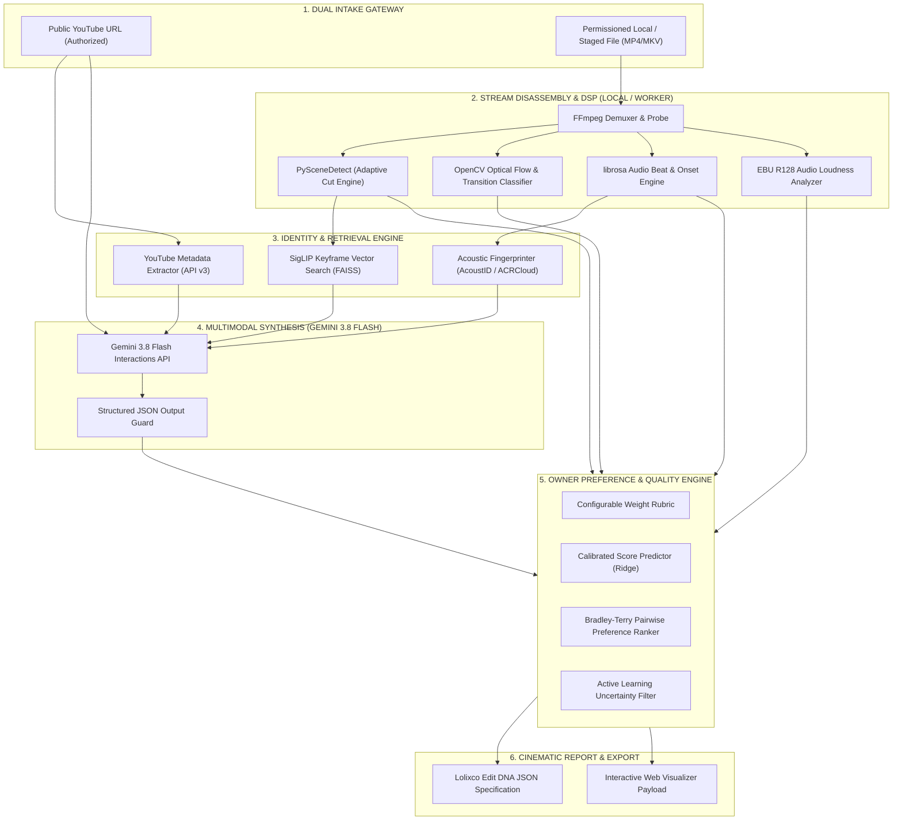
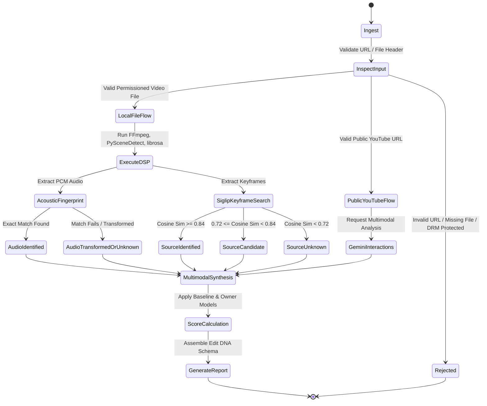

# LOLIXCO EDIT DNA — AI EDIT ANALYZER R&D
## SYSTEM ARCHITECTURE: MULTIMODAL VIDEO INTELLIGENCE & EDITING DNA PIPELINE
**Document ID:** `AI_EDIT_ANALYZER_ARCHITECTURE.md`  
**Mission:** Antigravity Mission 1 (Parallel Independent R&D)  
**Status:** Approved Technical Architecture  
**Author:** Antigravity AI Engineering & Research  
**Target Platform:** Lolixco Video Intelligence Engine ("Lolixco Edit DNA")

---

### 1. HIGH-LEVEL SYSTEM TOPOLOGY

Lolixco Edit DNA is architected as an asynchronous, decoupled, multi-tier analysis pipeline that fuses deterministic signal processing with multimodal neural foundation models. The system strictly segregates mathematical measurements (frame timestamps, beat grids, luminance curves) from qualitative editorial appraisals (storytelling, atmosphere, owner preferences).



---

### 2. DETAILED PIPELINE TIERS

#### Tier 1: Dual-Gateway Ingestion
The system accepts inputs through two distinct channels, each enforcing strict compliance boundaries:
1. **Channel A — Authorized YouTube URL:**
   - Designed for zero-byte local storage.
   - Leverages Google Gemini's native YouTube URI support (`client.interactions.create` with `{ "type": "video", "uri": url }`).
   - Fetches public YouTube Data API metadata (title, uploader, description, tags, duration).
   - Operates in **Semantic Synthesis Mode**: High-level narrative, franchise hypotheses, visual themes, and macro-pacing estimates. Explicitly abstains from sub-frame beat synchronization unless the user uploads authorized local source bytes.
2. **Channel B — Permissioned Local File:**
   - Operates on staged local assets (`.mp4`, `.mov`, `.mkv`, `.webm`).
   - Unlocks full **Deterministic Signal Processing (DSP)**: Byte-level demuxing, exact GOP parsing, PCM audio extraction, and frame-accurate cut detection.

#### Tier 2: Deterministic Signal Processing (DSP) Engine
Operates on local CPU/worker instances without GPU requirements.
- **Container Demuxing (`ffprobe` / `ffmpeg`):**
  - Extracts duration, stream codecs (`h264`, `hevc`, `av1`, `aac`), container FPS, pixel format, color space (`bt709`, `bt2020`), and average bitrate.
  - Generates downsampled 16-bit 44.1kHz mono PCM WAV stream for audio analysis.
- **Shot Boundary Detection (`PySceneDetect`):**
  - Runs `AdaptiveDetector` with rolling 8-frame window and 4-frame minimum shot duration constraint.
  - Outputs shot boundary list: $[(t_{\text{start}}^{(i)}, t_{\text{end}}^{(i)}, \Delta t^{(i)})]_{i=1}^N$.
  - Computes Average Shot Length (ASL), Cut Density (Cuts per second), and Shot Length Standard Deviation (Pacing Dynamic).
- **Transition Classification (`OpenCV`):**
  - Evaluates consecutive frames surrounding each boundary:
    * Hard Cut: Single-frame SSIM drop $<0.40$ with instantaneous luminance continuity.
    * Dissolve/Crossfade: Linear gradient over $\ge 3$ frames with optical flow divergence.
    * Flash Transition: Spike in average luminance $V \ge 92\%$ with rapid recovery.
    * Whip-Pan / Motion Transition: Dense Farneback optical flow magnitude $> 18.0\text{ px/frame}$.
- **Audio Rhythm & Quality (`librosa` + EBU R128):**
  - Onset detection via spectral novelty curve; beat grid tracking via dynamic programming.
  - BPM estimation with harmonic ambiguity resolution (distinguishing 70 BPM from 140 BPM).
  - Calculates millisecond delta between every cut and the nearest beat: $\delta_j = \min_k |t_{\text{cut}}(j) - t_{\text{beat}}(k)|$.
  - Calculates integrated loudness in LUFS, True Peak in dBTP, and Loudness Range (LRA).

#### Tier 3: Identification & Vector Retrieval Engine
- **Acoustic Fingerprinting:**
  - AcoustID (Chromaprint) runs locally on the PCM audio stream. Hashes are queried against the MusicBrainz database for zero-cost exact track identification.
  - If unmatched and commercial API is authorized, ACRCloud is queried for noisy/background music identification.
  - If both fail or audio is pitch/tempo transformed, the system flags the track as `"unmatched_or_transformed"` and reports estimated BPM and musical key without inventing a song title.
- **Keyframe Vector Search (SigLIP):**
  - Extracts the median frame from each detected shot.
  - Encodes frames into $d=1152$ embeddings using `google/siglip-so400m-patch14-384`.
  - Queries an indexed FAISS vector database containing keyframes from canon anime series, superhero films, and game trailers.
  - Returns Top-1 and Top-3 candidate matches with cosine similarity scores $s \in [0, 1]$.
  - Enforces strict abstention gate: $s < 0.72 \implies \text{abstain}$ (mark as "Unknown / Original Media").

#### Tier 4: Multimodal Synthesis (Gemini 3.8 Flash)
- **Model Ingestion:** Receives the video input alongside pre-computed DSP metrics (e.g., "The video contains 24 cuts with an ASL of 1.25s and an estimated BPM of 132").
- **Prompt Structure:** Instructs Gemini 3.8 Flash to evaluate higher-level semantic dimensions:
  1. Franchise and Character Context.
  2. Narrative Arc (e.g., "Villain introduction leading to climactic confrontation").
  3. Visual Atmosphere & Color Grading (e.g., "Moody neo-noir cyberpunk with saturated magenta accents").
  4. Editing Originality & Creativity Assessment.
- **Structured Output Guard:** Output is constrained via native JSON schema enforcement using the modern `response_format` object (`response_format: { type: "text", mime_type: "application/json", schema: ... }`). Generative text is parsed and validated against `EditDnaSynthesisSchema`.

#### Tier 5: Owner Quality Scoring & Personalization Engine
- **Three-Tier Score Separation:**
  1. `technical_metrics`: Raw objective data (ASL, BSI, clipping count, FPS, resolution).
  2. `editorial_estimates`: Industry-standard cinematic baseline score.
  3. `owner_predicted_preference`: Personalized score derived from the owner's trained preference model.
- **Editable Rubric:**
  $$\text{Score}_{\text{composite}} = \sum_{c \in \text{Categories}} w_c \cdot S_c$$
  where default provisional weights are:
  - Beat Synchronization ($w_{\text{beat}} = 0.25$)
  - Transitions ($w_{\text{trans}} = 0.20$)
  - Pacing ($w_{\text{pace}} = 0.15$)
  - Visual Quality ($w_{\text{vis}} = 0.15$)
  - Story & Emotional Impact ($w_{\text{story}} = 0.15$)
  - Originality & Creativity ($w_{\text{orig}} = 0.10$)
- **Pairwise Bradley-Terry Learning:**
  When the owner rates Edit A higher than Edit B ($A \succ B$), the preference model updates its latent weight vector $\boldsymbol{\theta}$ using gradient steps on the logistic log-likelihood:
  $$\mathcal{L}(\boldsymbol{\theta}) = \log \sigma\left(\boldsymbol{\theta}^T (\mathbf{x}_A - \mathbf{x}_B)\right)$$
- **Active Learning Queue:**
  Edits with high model uncertainty ($\sigma(\boldsymbol{\theta}^T (\mathbf{x}_A - \mathbf{x}_B)) \approx 0.50$) are flagged for owner review to maximize training data efficiency.

#### Tier 6: Report Generation & Serialization
- Compiles the final **Lolixco Edit DNA Document** (`edit_dna_report.json`).
- Generates lightweight SVG waveform previews, beat markers, and interactive timeline descriptors for UI rendering.

---

### 3. COMPLETE PIPELINE STATE MACHINE & ABSTENTION LOGIC

The analyzer implements a fail-safe state machine that guarantees transparency and honest uncertainty reporting:



#### Abstention Policies:
1. **Source Franchise Abstention:** If SigLIP cosine similarity $<0.72$ and Gemini confidence is categorized as `"low"`, the report sets `source_identification.status = "unknown_source"` with `confidence = 0.0`. It lists top candidate possibilities as speculative suggestions rather than asserting a fact.
2. **Episode Number Abstention:** Unless verified by an exact keyframe match against canonical database frames ($s \ge 0.92$), the episode field is returned as `null` with rationale `"insufficient_temporal_evidence"`.
3. **Music Identity Abstention:** If acoustic fingerprinting yields no match, the song title is returned as `"unmatched_track"` with descriptive tags (e.g., `"genre": "phonk", "tempo": 142, "key": "F# minor"`).
4. **Beat Sync Abstention (YouTube URL Mode):** When operating in pure YouTube URL mode without local audio demuxing, `beat_synchronization` is reported as `"unmeasured_url_mode"` with an explanation that frame-accurate synchronization requires local audio stream access.

---

### 4. DATA CONTRACT: LOLIXCO EDIT DNA JSON SPECIFICATION

The formal data schema produced by the analyzer engine:

```json
{
  "$schema": "https://lolixco.com/schemas/edit-dna.v1.json",
  "analysis_id": "dna_20261102_jk_sukuna_001",
  "analyzed_at": "2026-11-02T13:30:00Z",
  "intake_mode": "local_permissioned_file",
  "asset_metadata": {
    "filename": "sukuna_flame_arrow_30s.mp4",
    "duration_seconds": 30.12,
    "dimensions": { "width": 1080, "height": 1920, "aspect_ratio": "9:16" },
    "framerate_fps": 30.0,
    "video_codec": "h264",
    "audio_codec": "aac",
    "bitrate_kbps": 12450
  },
  "source_intelligence": {
    "status": "identified",
    "top_match": {
      "franchise": "Jujutsu Kaisen",
      "canonical_title": "Jujutsu Kaisen Season 2 (Shibuya Incident)",
      "character_focus": ["Ryomen Sukuna", "Jogo"],
      "confidence": 0.94,
      "evidence_type": "siglip_keyframe_match_and_vlm_confirmation"
    },
    "episode_attribution": {
      "episode_identified": "Season 2 Episode 16",
      "confidence": 0.88,
      "verification_method": "keyframe_database_match"
    },
    "alternative_candidates": [
      { "franchise": "Chainsaw Man", "confidence": 0.04 }
    ]
  },
  "music_intelligence": {
    "status": "identified_pitch_shifted",
    "track": {
      "title": "Murder in My Mind",
      "artist": "Kordhell",
      "album": "Murder in My Mind",
      "isrc": "QZDA42200001",
      "confidence": 0.91,
      "identification_engine": "acrcloud_normalized_query"
    },
    "transformation": {
      "is_transformed": true,
      "pitch_shift_semitones": -1.5,
      "tempo_multiplier": 0.92,
      "classification": "slowed_and_reverb_phonk"
    },
    "musical_characteristics": {
      "estimated_bpm": 128.5,
      "time_signature": "4/4",
      "key_scale": "D# minor",
      "beat_count": 64
    },
    "audio_engineering": {
      "integrated_loudness_lufs": -11.2,
      "true_peak_dbtp": -0.8,
      "loudness_range_lra": 4.5,
      "clipping_detected": false,
      "volume_consistency_score": 9.2
    }
  },
  "technical_editing_metrics": {
    "total_shots": 28,
    "average_shot_length_seconds": 1.07,
    "cut_density_cps": 0.93,
    "pacing_variance": 0.42,
    "transitions_breakdown": {
      "hard_cuts": 22,
      "flash_transitions": 4,
      "whip_pan_motion_blur": 2,
      "dissolves": 0
    },
    "synchronization": {
      "beat_sync_index": 8.75,
      "tight_cuts_count": 21,
      "acceptable_cuts_count": 5,
      "off_beat_cuts_count": 2,
      "mean_sync_delta_ms": 38.4
    },
    "visual_consistency": {
      "color_gamut_entropy": 4.12,
      "mean_luminance": 0.41,
      "color_continuity_score": 8.8
    }
  },
  "quality_scoring": {
    "provisional_weights": {
      "beat_synchronization": 0.25,
      "transitions": 0.20,
      "pacing": 0.15,
      "visual_quality": 0.15,
      "storytelling_emotion": 0.15,
      "originality_creativity": 0.10
    },
    "component_scores": {
      "beat_synchronization": 8.75,
      "transitions": 9.00,
      "pacing": 8.50,
      "visual_quality": 8.80,
      "storytelling_emotion": 8.00,
      "originality_creativity": 7.50
    },
    "aggregate_scores": {
      "objective_technical_score": 8.76,
      "general_editorial_estimate": 8.52,
      "owner_predicted_preference": 8.65,
      "uncertainty_margin": 0.35
    }
  },
  "editorial_synthesis": {
    "narrative_arc": "Rapid climactic confrontation escalating from Jogo's fire attacks into Sukuna's domain expansion.",
    "atmosphere_mood": "Ominous, catastrophic, highly energized with explosive warm lighting.",
    "signature_highlights": [
      "Frame-perfect impact flash at 00:14.20 aligned with 808 sub-bass drop.",
      "High visual dynamic range preserving shadow detail in dark city destruction scenes."
    ],
    "critique_and_recommendations": [
      "The cut at 00:22.10 lands 110ms late relative to the downbeat, momentarily breaking flow.",
      "Consider smoothing the hard cut into the final title card with a 3-frame luminance dip."
    ]
  }
}
```

---

### 5. ARCHITECTURAL VALIDATION & ISOLATION COMPLIANCE

- **Isolation Rule Check:** This architecture operates entirely on self-contained modules. It makes zero writes to production catalogs (`content/baseline/edits.ts` remains intact and protected).
- **AWS Infrastructure Rule Check:** The architecture mandates local CPU/Worker processing for DSP. No AWS EC2 instances, S3 buckets, or chargeable cloud resources will be deployed without owner authorization.
- **Copyright & Scrape Rule Check:** The architecture strictly prohibits downloading or ripping audiovisual streams from YouTube.

This architecture forms the operational foundation for the scoring and feedback mechanics detailed in `SCORING_AND_OWNER_FEEDBACK.md`.
