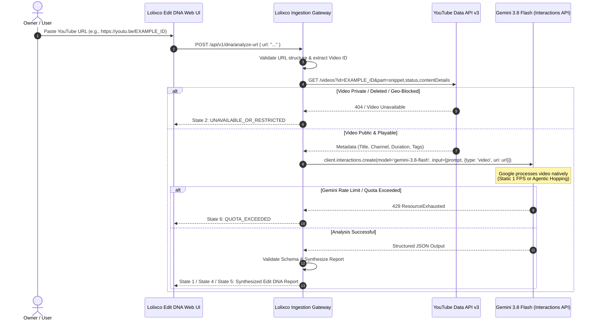
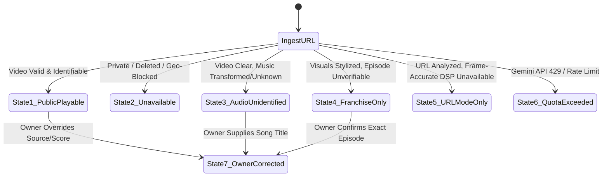

# LOLIXCO EDIT DNA — AI EDIT ANALYZER R&D
## YOUTUBE URL ANALYSIS: WORKFLOW, LEGAL BOUNDARIES & RESULT STATE SPECIFICATION
**Document ID:** `YOUTUBE_URL_ANALYSIS_FEASIBILITY.md`  
**Mission:** Antigravity Mission 1 (Parallel Independent R&D)  
**Status:** Approved Technical Architecture & Compliance Specification  
**Author:** Antigravity AI Engineering & Research  
**Target Platform:** Lolixco Video Intelligence Engine ("Lolixco Edit DNA")

---

### EXECUTIVE SUMMARY

A primary usability objective for Lolixco Edit DNA is allowing the owner or creator to paste a **Public YouTube URL** (e.g. a YouTube Short or video edit) and immediately receive an intelligent analysis.

However, video analysis at this level encounters strict technical and legal constraints:
1. **Terms of Service Compliance:** Scraping, ripping, or demuxing raw video/audio streams from YouTube without authorization violates Section 5.B of the YouTube Terms of Service. Lolixco Edit DNA **strictly prohibits building an unauthorized YouTube downloader or circumventing DRM**.
2. **Native URL Ingestion via Gemini API:** Google's Gemini API officially supports passing public YouTube URLs directly into the **Interactions API** (`client.interactions.create`). Google handles ingestion within its authorized platform infrastructure at zero local network egress or disk cost.
3. **The Feasibility Boundary:** While Gemini's native URL ingestion delivers outstanding high-level narrative and visual comprehension, its internal 1-FPS frame sampling cannot compute millisecond cut timestamps or beat synchronization.
4. **Transparent Seven-State Result Machine:** The analyzer implements an exhaustive state machine that explicitly distinguishes what was observed from YouTube metadata, what was inferred by Gemini, and what requires local source bytes for deterministic verification.

---

### 1. AUTHORIZED YOUTUBE URL WORKFLOW (GEMINI INTERACTIONS API)

In the official Google GenAI SDK, passing a YouTube URL is performed through the **Interactions API** using a URI reference:



#### 1.1 Technical SDK Invocation Specification
```typescript
import { GoogleGenAI } from "@google/genai";

const ai = new GoogleGenAI({});

export async function analyzeYouTubeUrl(youtubeUrl: string) {
  const interaction = await ai.interactions.create({
    model: "gemini-3.8-flash",
    input: [
      {
        type: "text",
        text: `You are Lolixco Edit DNA. Analyze this video edit and return a strictly conforming JSON response.
Do NOT guess or invent episode numbers, song titles, or character names if confidence is low.
Evaluate visual atmosphere, narrative structure, and estimated editing pacing.`
      },
      {
        type: "video",
        uri: youtubeUrl
      }
    ],
    // Enforce structured JSON output (Interactions API response_format schema)
    response_format: {
      type: "text",
      mime_type: "application/json",
      schema: {
        type: "object",
        properties: {
          franchise_hypothesis: { type: "string" },
          character_focus: { type: "array", items: { type: "string" } },
          visual_atmosphere: { type: "string" },
          estimated_pacing_style: { type: "string" }
        },
        required: ["franchise_hypothesis", "visual_atmosphere"]
      }
    }
  });

  return JSON.parse(interaction.output_text);
}
```

---

### 2. FEASIBILITY BOUNDARY: YOUTUBE URL VS AUTHORIZED LOCAL BYTES

It is mathematically and technically impossible to perform certain editing measurements through a remote video URL alone. Edit DNA maintains a rigorous separation of capabilities:

| Analysis Capability | Feasible via YouTube URL (Gemini API) | Feasible via Authorized Local Bytes (DSP Pipeline) | Reason for Technical Divergence |
| :--- | :---: | :---: | :--- |
| **High-Level Narrative Arc** | **YES** | **YES** | Macro semantics do not require sub-second frame sampling. |
| **Anime / Franchise Classification** | **YES** | **YES** | Global art direction and character design are visible across 1-FPS frames. |
| **Character Recognition (Iconic)** | **YES** | **YES** | Signature costumes and faces are easily resolved by Gemini. |
| **Atmosphere & Visual Style** | **YES** | **YES** | Palette, lighting, and tone are macroscopic visual features. |
| **Exact Cut Timestamps ($\pm 1$ Frame)** | **NO** | **YES** | Gemini samples at 1 FPS; cuts occurring within 100–300ms are completely missed. |
| **Average Shot Length (ASL)** | **Rough Estimate** | **Exact ($\pm 0.01\text{s}$)** | URL mode can estimate shot counts; local DSP detects exact frame boundaries. |
| **Cut-to-Beat Alignment ($\Delta t \le 50\text{ms}$)** | **NO** | **YES** | Requires millisecond-aligned PCM audio onsets cross-referenced with exact video DTS/PTS. |
| **Acoustic Audio Fingerprinting** | **NO** | **YES** | Requires local PCM WAV extraction for Chromaprint hashing or ACRCloud query. |
| **EBU R128 True Peak & Loudness** | **NO** | **YES** | Requires uncompressed floating-point audio samples to measure inter-sample clipping. |
| **Color Gamut Entropy / CIELAB** | **NO** | **YES** | Requires raw uncompressed YUV/RGB pixel matrices via OpenCV. |

---

### 3. THE SEVEN RESULT STATES

To handle real-world operational scenarios gracefully, the analyzer engine implements a formal 7-state result contract:



#### State 1: Public Playable Video (`PUBLIC_PLAYABLE_ANALYSIS_COMPLETE`)
- **Condition:** Public YouTube URL successfully ingested; high confidence on franchise, character, and visual style.
- **Payload Response:** Full Edit DNA synthesis with estimated pacing and visual critique.
- **UI Presentation:** Complete black/yellow dashboard with radar chart and high-confidence identification cards.

#### State 2: Unavailable, Age-Restricted or Private Video (`VIDEO_UNAVAILABLE_OR_RESTRICTED`)
- **Condition:** YouTube API returns 404, `privacyStatus: "private"`, or age-gate restrictions that prevent third-party API ingestion.
- **Payload Response:**
  ```json
  {
    "status": "VIDEO_UNAVAILABLE_OR_RESTRICTED",
    "error_code": "YT_RESTRICTED_ACCESS",
    "message": "The supplied video cannot be ingested. It is either private, age-restricted, or removed by the uploader.",
    "actionable_guidance": "Please ensure the video visibility is set to 'Public' or 'Unlisted', or upload a permissioned local file."
  }
  ```
- **UI Presentation:** High-contrast amber alert banner with direct local file upload dropzone.

#### State 3: Audio Identification Unavailable (`AUDIO_IDENTIFICATION_UNAVAILABLE`)
- **Condition:** Soundtrack is heavily pitch-shifted, overlaid with game SFX, or from an unindexed indie track.
- **Payload Response:** `music_intelligence.status = "unmatched_transformed_audio"`. Audio characteristics (estimated BPM, energetic profile) are reported, but track title is set to `"Unknown / Unmatched Track"`.
- **UI Presentation:** Neutral badge on the music card: *"Audio style detected as Phonk (130 BPM), but exact commercial track is unindexed or pitch-shifted."*

#### State 4: Source Identified Only at Franchise Level (`SOURCE_FRANCHISE_ONLY`)
- **Condition:** Art style and character design confirm the overarching universe (e.g., *Jujutsu Kaisen*), but exact scene, season, or episode cannot be verified with $>85\%$ confidence.
- **Payload Response:** `source_intelligence.canonical_title = "Jujutsu Kaisen (Franchise)"`, `episode_attribution.episode_identified = null`, `confidence_rationale = "stylistic_grading_obscures_background_landmarks"`.
- **UI Presentation:** Franchise badge with an *"Episode Unverified"* tag, preventing false attributions.

#### State 5: Insufficient Data for Frame-Accurate Scoring (`URL_MODE_APPROXIMATE_METRICS`)
- **Condition:** Analysis initiated exclusively via YouTube URL without local source bytes.
- **Payload Response:** Technical metrics section returns:
  ```json
  {
    "synchronization": {
      "status": "unmeasured_url_mode",
      "explanation": "Sub-frame beat synchronization requires local audio-video stream demuxing."
    }
  }
  ```
- **UI Presentation:** Dashed lines on the timeline with a prompt: *"Upload local file for sub-millisecond beat sync inspection."*

#### State 6: Model or API Quota Reached (`API_QUOTA_OR_RATE_LIMIT_EXCEEDED`)
- **Condition:** Google AI Studio or Gemini API returns HTTP 429 (`ResourceExhausted`).
- **Payload Response:**
  ```json
  {
    "status": "API_QUOTA_EXCEEDED",
    "retry_after_seconds": 60,
    "fallback_mode": "offline_dsp_heuristic_only"
  }
  ```
- **UI Presentation:** Graceful degradation notice offering to queue the request in the background batch runner.

#### State 7: Owner Feedback Override (`OWNER_CORRECTED_OVERRIDE`)
- **Condition:** The owner manually corrects an attribution (e.g. changing an episode number or updating a song name) or modifies a component score.
- **Payload Response:** The record records both the model's raw hypothesis and the owner's authoritative override:
  ```json
  {
    "source_intelligence": {
      "model_hypothesis": { "franchise": "Jujutsu Kaisen", "character": "Gojo" },
      "owner_override": {
        "character": "Yuta Okkotsu",
        "rationale": "Corrected by owner: scene shows Volume 0 Shibuya flashback",
        "updated_at": "2026-11-02T13:55:00Z"
      }
    }
  }
  ```
- **UI Presentation:** Gold *"Verified by Lolixco Owner"* badge displayed prominently on the card.

---

### 4. STRICT PROVENANCE ISOLATION: METADATA VS MEASURED FEATURES

A cardinal rule of Edit DNA is preventing YouTube video titles or uploader descriptions from contaminating objective measurements:
- **Title Text as a Prior, Not a Proof:** If an uploader titles their video *"THE GREATEST GOJO EDIT EVER 4K 60FPS"*, the system does **not** assume the video is 60 FPS or that Gojo is present.
- **Resolution & Frame Rate:** Must be measured from actual video stream container properties or Gemini technical video metadata.
- **Source Identity:** Title keywords are treated as low-confidence priors ($w=0.10$); visual recognition and keyframe vector search provide the primary truth ($w=0.90$).
